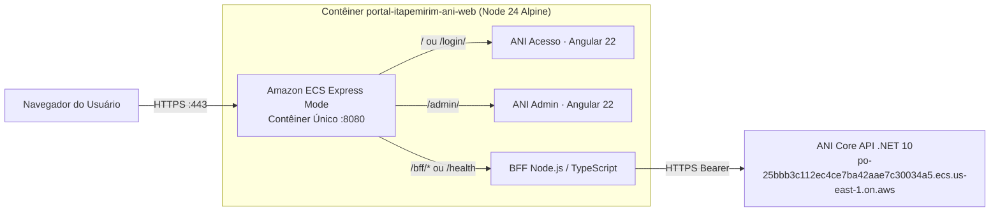

# Guia de Deploy em Homologação — Portal Itapemirim Web (Angular + BFF)

Este documento centraliza todas as configurações e instruções para compilar, executar localmente em Docker e publicar o **Portal Itapemirim Web** (`ani-login`, `ani-admin` e `BFF Node.js`) na **Amazon Web Services (AWS)** utilizando o **Amazon ECR** e o **Amazon ECS Express Mode**.

---

## 📌 1. Visão Geral da Arquitetura do Contêiner Único



### Rotas da Aplicação na Mesma URL Pública:
* **`/`**: Redireciona automaticamente para `/login/`.
* **`/login/`**: Aplicação Angular **ANI Acesso** (`ani-login`) — Login, recuperação de senha e criação de conta.
* **`/admin/`**: Aplicação Angular **ANI Admin** (`ani-admin`) — Console administrativo, usuários, perfis, sistemas, permissões, auditoria e Meu Perfil.
* **`/bff/*`**: API do BFF (gerenciamento de sessão por cookie `HttpOnly` `SameSite=Strict`, proteção CSRF e integração segura com o Core).
* **`/health`** (e `/bff/health`): Endpoint de monitoramento de saúde respondendo HTTP `200 OK`.

---

## ☁️ 2. Dados da Imagem Publicada no Amazon ECR

A imagem Docker já foi compilada e enviada para a sua conta AWS:
* **Perfil AWS CLI**: `duilio-FariasTec`
* **Região**: `us-east-1`
* **Account ID**: `107189286518`
* **Repositório ECR**: `portal-itapemirim-ani-web`
* **URI Oficial da Imagem**: `107189286518.dkr.ecr.us-east-1.amazonaws.com/portal-itapemirim-ani-web:latest`

---

## 🚀 3. Passo a Passo no Console AWS (ECS Express Mode)

1. Acesse o console do **[Amazon ECS Express Mode (us-east-1)](https://us-east-1.console.aws.amazon.com/ecs/v2/express-mode?region=us-east-1)**.
2. Clique em **Create service** (Criar serviço).
3. Preencha os campos principais conforme a tabela abaixo:

| Campo no Console | Valor a Preencher | Observações |
| :--- | :--- | :--- |
| **Service name** | `itapemirim-portal-web` | Nome do serviço front-end + BFF |
| **Container image URI** | `107189286518.dkr.ecr.us-east-1.amazonaws.com/portal-itapemirim-ani-web:latest` | URI publicada no ECR |
| **Container port** | `8080` | Porta interna exposta pelo contêiner |
| **Health check path** | `/health` | Endpoint de saúde (retorna HTTP 200) |
| **Protocol** | `HTTP` | O ECS gerencia o certificado HTTPS na borda |

4. **Environment Variables (Variáveis de Ambiente)**:
   *(Todas estas variáveis já estão pré-configuradas como padrão dentro do `Dockerfile`, mas você pode sobrescrevê-las no console do ECS se desejar)*:
   * `NODE_ENV`: `homologation`
   * `ANI_BFF_HOMOLOGATION`: `true`
   * `ANI_BFF_PORT`: `8080`
   * `ANI_CORE_BASE_URL`: `https://po-25bbb3c112ec4ce7ba42aae7c30034a5.ecs.us-east-1.on.aws`
   * `ANI_BFF_ENABLE_WRITES`: `true` *(habilita cadastros, edições e troca de senha)*
   * `ANI_BFF_ENABLE_PUBLIC_REGISTRATION`: `false` *(mude para `true` se quiser liberar o botão "Criar conta" na tela de login)*
   * `ANI_LOGIN_FRONTEND_URL`: `/login/`
   * `ANI_ADMIN_FRONTEND_URL`: `/admin/`

5. Clique em **Create & deploy**.
6. Aguarde cerca de 2 a 3 minutos até o serviço ficar **Active** e acesse a URL HTTPS gerada pela AWS!

---

## 💻 4. Como Testar Localmente via Docker

Caso queira testar exatamente o mesmo contêiner de homologação na sua máquina:

```powershell
# Subir o contêiner em background na porta 8080
docker compose up -d --build

# Acompanhar os logs
docker compose logs -f

# Parar o contêiner
docker compose down
```

* **Acesso Local (Login)**: [http://localhost:8080/login/](http://localhost:8080/login/)
* **Administração Local**: [http://localhost:8080/admin/](http://localhost:8080/admin/)
* **Health Check**: [http://localhost:8080/health](http://localhost:8080/health)

---

## 🔄 5. Como Atualizar o Front-end na AWS (Redeploy)

Sempre que fizer alterações nas telas Angular ou no BFF:

```powershell
# 1. Autenticar no ECR (caso o token tenha expirado)
$token = & 'C:\Users\Duilio Farias\AppData\Local\Programs\Amazon\AWSCLIV2\aws.exe' ecr get-login-password --region us-east-1 --profile duilio-FariasTec
docker login --username AWS --password $token 107189286518.dkr.ecr.us-east-1.amazonaws.com

# 2. Compilar a nova versão da imagem
docker build -t portal-itapemirim-ani-web:latest .

# 3. Aplicar a tag e enviar para o ECR
docker tag portal-itapemirim-ani-web:latest 107189286518.dkr.ecr.us-east-1.amazonaws.com/portal-itapemirim-ani-web:latest
docker push 107189286518.dkr.ecr.us-east-1.amazonaws.com/portal-itapemirim-ani-web:latest
```

Em seguida, no console do **Amazon ECS**, abra o serviço `itapemirim-portal-web`, clique em **Update service**, marque **Force new deployment** e confirme em **Update**.

