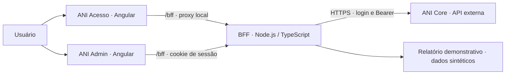

# ANI · Autorizador Nova Itapemirim

Portal de acesso e administração de usuários, perfis e permissões, com experiências próprias para autenticação e operação administrativa.

Este repositório reúne o **front-end Angular, o BFF Node.js/TypeScript e a documentação do projeto**. A API ANI Core é desenvolvida em outra frente e consumida pelo BFF; sua implementação não está neste repositório.

> **Estado atual:** integração local com o Core de QA para login e consultas administrativas. A V1 ainda possui pendências funcionais e de preparação para release. O relatório de acessos utiliza dados sintéticos identificados na tela.

## A ideia do projeto

O ANI organiza o acesso às aplicações e oferece um console para administrar identidades e permissões.

| Experiência | Responsabilidade atual |
|---|---|
| **ANI Acesso · `ani-login`** | Login e senha, sessão, resultado da autenticação e tela de solicitação de cadastro |
| **ANI Admin · `ani-admin`** | Visão geral, solicitações, usuários, sistemas, perfis, permissões, auditoria e relatórios |

Os aplicativos possuem projetos e bundles próprios, compartilhando contratos e identidade visual. A integração com outros sistemas consumidores e a adoção de um provedor OIDC continuam como temas de arquitetura a definir.

## Arquitetura atual



- **Angular:** apresenta as telas, mantém o estado da interface e chama o BFF com `HttpClient`.
- **BFF:** mantém a sessão, valida chamadas, adapta contratos e encaminha operações permitidas ao Core.
- **Core:** autentica o usuário e é a autoridade de autorização e regras de negócio.
- **Bibliotecas compartilhadas:** centralizam tipos e tokens visuais, sem armazenar credenciais.

O Bearer recebido no login permanece no servidor. O navegador recebe cookie de sessão opaco `HttpOnly`; tokens não são colocados em URLs ou Web Storage.

## Como ficou o front-end

```text
front-end/
├── apps/
│   ├── ani-login/                  # Acesso e solicitação de cadastro
│   └── ani-admin/                  # Console administrativo
├── libs/
│   ├── api-contracts/src/          # DTOs e tipos compartilhados
│   └── design-tokens/src/          # Tema e tokens visuais SCSS
├── bff/
│   ├── ani-admin/src/              # Integração Core, sessão e adaptação
│   ├── mock-ani-core/              # API sintética para demonstração
│   └── mock-identity-provider/     # Identidade simulada para demonstração
├── docs/                          # Fluxos, contratos, arquitetura e pendências
├── angular.json                   # Configuração dos dois projetos
└── proxy.conf.json                # /bff → 127.0.0.1:3333 no desenvolvimento
```

O workspace utiliza **Angular 22, TypeScript 6, RxJS e SCSS**, com aplicações standalone. Cada aplicativo mantém configuração e serviços próprios.

No Admin, `core/api` concentra o cliente do BFF e `core/auth` reúne sessão, guarda e CSRF. No Login, os serviços de autenticação e solicitação ficam em `core`. As telas e o shell ainda estão concentrados em `app.ts`, `app.html` e `app.scss`; a divisão em componentes por domínio é uma evolução proposta.

A interface oferece sidebar no desktop, menu lateral no celular e tabelas adaptadas para cartões. Carregamento, falha e lista vazia são estados distintos. O perfil `Administrador`, confirmado pelo Core, recebe navegação para todas as áreas; isso não substitui autorização da API nem habilita escritas automaticamente.

→ Consulte o [guia do front-end](front-end/README.md) para detalhes de implementação.

## Situação dos módulos

| Módulo | Situação atual |
|---|---|
| Login, sessão e logout | Integrados ao Core; fluxo exercitado em QA autorizado com conta sintética |
| Usuários | Listagem integrada e verificada; paginação e status adaptados pelo BFF |
| Perfis e permissões | Rotas e adaptadores implementados; homologação completa pendente |
| Auditoria | Consultas encaminhadas ao Core; validação funcional completa pendente |
| Sistemas e solicitações | Telas existentes; endpoints necessários ausentes no OpenAPI analisado |
| Relatórios de acesso | Demonstração explícita com dados sintéticos; endpoint real pendente |
| Escritas administrativas | Desabilitadas por padrão; validação ponta a ponta pendente |

Disponibilidade de menu ou implementação de rota não significa funcionalidade homologada.

## Executar localmente

Requisitos: **Node.js >=24.15 e <25** e **npm 11+**.

```bash
cd front-end
npm ci
cp bff/ani-admin/.env.example bff/ani-admin/.env.local
```

Configure `ANI_CORE_BASE_URL` em `.env.local` com a origem HTTPS do ambiente autorizado. Mantenha `ANI_BFF_ENABLE_WRITES=false` para trabalhar somente com consultas.

Em três terminais, dentro de `front-end/`:

```bash
npm run bff:api
```

```bash
npm run start:login
```

```bash
npm run start:admin
```

| Serviço | Endereço local |
|---|---|
| ANI Admin | http://127.0.0.1:4200 |
| ANI Acesso | http://127.0.0.1:4201 |
| BFF | http://127.0.0.1:3333 |

Abra o Admin. Sem sessão, ele encaminha ao Login; após autenticar, use **Continuar para administração**. Não há chave de integração local no fluxo atual. O [guia do front-end](front-end/README.md) também descreve a demonstração isolada.

## Caminho para V1 e QA

1. Alinhar schemas de resposta, erros e autorização com o responsável pelo Core.
2. Disponibilizar sistemas/portais e solicitação/aprovação de cadastro; definir provisionamento e duplicidade.
3. Substituir o relatório demonstrativo quando o contrato real estiver disponível.
4. Validar consultas, filtros, detalhes e escritas autorizadas por perfil, com dados sintéticos.
5. Resolver o orçamento CSS do Admin: o último build de produção registrado excedeu o limite de 12 kB do componente.
6. Concluir QA responsivo, acessibilidade, sessão, erros e segurança; preparar controles de produção.

O BFF atual é exclusivo de desenvolvimento local e bloqueia execução em produção. Sessões em memória, limites locais e cookies para HTTP loopback precisam de desenho apropriado antes de implantação. Cognito/OIDC e infraestrutura AWS permanecem propostas conforme as decisões documentadas.

## Documentação

| Tema | Referência |
|---|---|
| Front-end | [Guia do workspace](front-end/README.md) |
| Integração | [Conexão com o Core](front-end/docs/conexao-core.md) |
| Login e V1 | [Levantamento ponta a ponta](front-end/docs/v1-login-ponta-a-ponta.md) |
| Interface | [Arquitetura UI e design system](front-end/docs/arquitetura-ui-design-system.md) |
| Contexto e arquitetura | [Contexto](contexto/README.md) · [Arquitetura ANI](docs/arquitetura-ani.md) |
| Decisões | [Pendências](docs/decisoes-e-pendencias.md) · [Decisões aprovadas](decisoes/README.md) |
| Segurança | [Controles](seguranca/README.md) · [Instruções do projeto](AGENTS.md) |
| Outras frentes | [Back-end](back-end/README.md) · [Banco](database/README.md) · [Infraestrutura](infrastructure/README.md) · [Testes](tests/README.md) |

Documentos históricos incluem propostas anteriores. Para o funcionamento atual, comece por este README e pelo guia do front-end; propostas não equivalem a decisões aprovadas.

## Versionamento

Destino informado: [duilio-FariasTec/portal_itapemirim](https://github.com/duilio-FariasTec/portal_itapemirim). Código, contratos, testes e documentação fazem parte do versionamento. Arquivos `.env.local`, credenciais, dependências, builds e evidências em `outputs/` ficam fora do Git. Use somente dados sintéticos e nunca registre senhas ou tokens.
