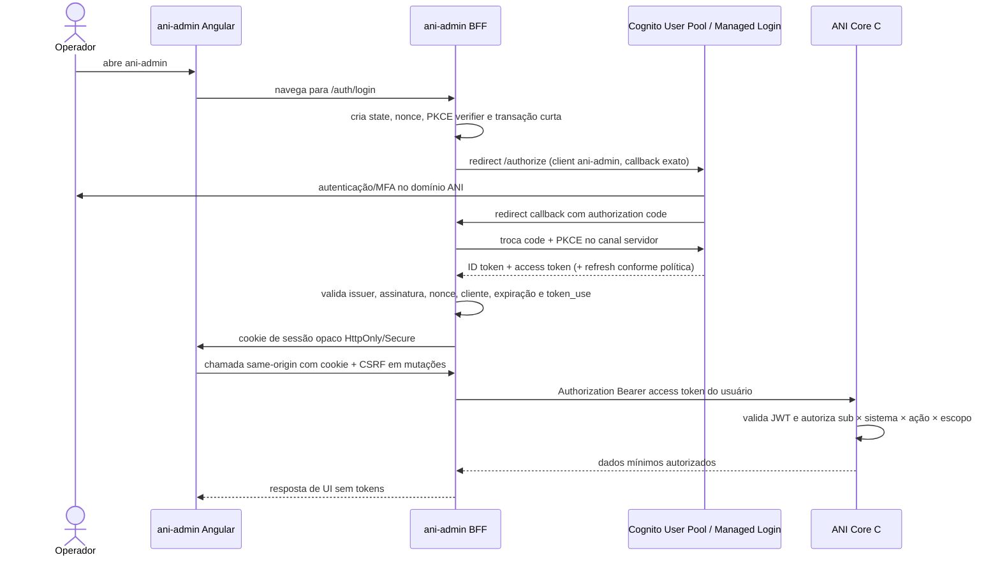

# Arquitetura proposta de identidade e integração ANI

**Estado:** recomendação técnica para decisão. AWS é a plataforma-alvo informada; Amazon Cognito User Pools é o candidato recomendado para identidade. Não representa provisionamento já feito nem substitui revisão de segurança/contrato com o analista da API.

## Recomendação executiva

1. Usar **Amazon Cognito User Pools** como provedor de identidade gerenciado (IdP) do ANI. O ANI Core continua responsável por autorização empresarial: que aplicações a pessoa pode usar e o que ela pode fazer em cada uma.
2. Usar **OpenID Connect (OIDC) sobre OAuth 2.0**, com **Authorization Code + PKCE (`S256`)**. Cada aplicação é um cliente registrado, com callback exato e escopos mínimos.
3. Para `ani-admin`, usar um BFF Node.js/TypeScript dedicado e confidencial. Angular mantém apenas cookie de sessão opaco; BFF mantém tokens no servidor e chama o Core com o access token delegado do usuário.
4. Para a intranet, preferir também um BFF próprio se for possível. Se ela continuar sem backend, tratá-la como **cliente público SPA**: Authorization Code + PKCE, sem segredo, e access token somente em memória; o ANI Core/API deve validar o token e autorizar cada chamada. Nunca usar a tela Angular como prova de autorização.
5. Hospedar o início de autenticação no domínio ANI por redirect de nível superior. Não recolher a senha no domínio do consumidor nem criar endpoints/tokens proprietários no Core para substituir OIDC.

Amazon Cognito Managed Login fornece páginas gerenciadas para sign-in, MFA e recuperação e suporta integração OIDC/OAuth. As opções de personalização visual têm limites; não permitem transformar completamente a página no wireframe Angular. Decidir explicitamente entre aceitar a tela hospedada com marca ANI ou reavaliar um IdP gerenciado que permita maior controle visual. Não contornar essa limitação criando um broker OAuth próprio sem análise de segurança. A documentação AWS distingue Managed Login de formulários próprios que chamam APIs do Cognito; para múltiplas aplicações, Managed Login + endpoints padrão OIDC é o caminho recomendado aqui.

## O que cada parte faz

| Parte | Responsabilidade | O que não deve fazer |
|---|---|---|
| Cognito User Pool | Identidade ANI, credenciais, MFA, recuperação, sessão de autenticação, emissão/rotação de tokens | Decidir sozinho o acesso de negócio a cada registro/ação ANI |
| `ani-login`/Managed Login | Apresentar o fluxo central de autenticação na origem/domínio ANI | Devolver senha, token ou permissões em query string; rodar dentro da origem não confiável do consumidor |
| ANI Core C# | Resolver o `sub` autenticado para a identidade ANI; verificar concessão por sistema, permissão e escopo; proteger os endpoints; auditar | Confiar em perfil, e-mail, usuário ou permissões enviados pelo browser |
| `ani-admin` Angular | Apresentar telas, chamar o BFF same-origin e mostrar capacidades da sessão | Guardar segredo/token privilegiado, acessar SQL ou ser barreira de segurança |
| `ani-admin-bff` | Cliente OIDC confidencial, callback, sessão server-side, CSRF, adaptação allowlisted e chamadas autenticadas ao Core | Ser proxy genérico, decidir permissões finais ou apagar o sujeito humano usando apenas uma conta técnica |
| BFF/API do consumidor | Manter a sessão e autorizar operações do próprio sistema consumidor, quando existir backend | Considerar um botão oculto ou JSON recebido do browser prova de acesso |

As credenciais e hashes ficam no Cognito, não no SQL ANI. No modelo ANI, persistir uma chave de identidade externa estável (por exemplo, issuer + `sub`) associada ao usuário de negócio; não usar e-mail como identificador imutável. Confirmar esse contrato com o analista da API antes de fechar endpoints/schema.

## Fluxo recomendado para `ani-admin`

**Validação no Core:** aceitar somente access tokens. Validar criptograficamente assinatura com JWKS do issuer esperado, `iss`, expiração/`nbf`, `token_use=access`, cliente (`client_id`) e audience/recurso se o token tiver resource binding, além de scopes mínimos. Não usar ID token para autorizar chamadas API. Em Cognito, access token sem resource binding identifica o app client em `client_id`; com resource binding, Cognito usa o recurso em `aud`. Implementar esta diferença explicitamente e cobrir com testes.

O access token do usuário, obtido pelo BFF como cliente `ani-admin`, preserva o sujeito no Core. O Core mapeia `sub` para a identidade ANI e consulta concessões/permissões atuais. O BFF guarda tokens somente server-side; se armazenar sessão/tokens em AWS, restringir acesso e proteger dados em repouso com KMS, TTL e revogação. Não enviar token ao Angular. Limitar o access token a audiência e scopes da API ANI.

## Fluxo da intranet e consumidores sem backend

**Opção preferida:** a intranet mantém BFF próprio e usa fluxo confidencial semelhante ao `ani-admin`; cada sistema mantém sua sessão, configuração e autorização local. ANI centraliza identidade e concessões, não a sessão HTTP de todos os consumidores.

**Se a intranet realmente não tiver backend:** registrá-la como cliente público. Usar Authorization Code + PKCE, callback exato e scopes mínimos. Não configurar nem distribuir `client_secret`. Manter access token apenas em memória, não em `localStorage`/`sessionStorage`; configurar CSP e proteção contra XSS; chamar API protegida diretamente com HTTPS. A API ANI valida o token e resolve permissões em cada chamada. Essa opção expõe mais credencial ao runtime do navegador do que o padrão BFF e precisa ser aceita no modelo de ameaça. O ANI não pode devolver uma lista de acessos que o consumidor trate como autorização suficiente para seus próprios endpoints.

O consumidor inicia o login por redirect e recebe um authorization code de uso único no callback registrado. Não retornar credenciais, access token em URL, permissões assinadas por JavaScript ou URL de retorno arbitrária. A aplicação consumidora valida o fluxo no backend (cliente confidencial) ou pelo fluxo de cliente público padrão (SPA); APIs de negócio continuam autorizando cada operação.

## Como entender permissões por sistema, recurso, ação e escopo

É a decomposição de uma decisão de acesso, não uma exigência de criar quatro tabelas idênticas:

| Dimensão | Pergunta simples | Exemplo ilustrativo |
|---|---|---|
| Sistema | Em qual aplicação? | `ani-admin`, `intranet`, `sistema-a` |
| Recurso | Sobre qual dado/função? | `usuarios`, `solicitacoes`, `perfis`, `auditoria` |
| Ação | O que pode fazer? | `consultar`, `criar`, `editar`, `aprovar`, `revogar`, `exportar` |
| Escopo | Sobre quais registros/contexto? | somente usuários vinculados ao Sistema A; ou apenas a unidade permitida |

Uma decisão completa poderia ser: “no Sistema A, consultar usuários vinculados ao próprio Sistema A, sem editar nem exportar”. Outro acesso poderia permitir “no `ani-admin`, aprovar solicitações apenas dos sistemas sob responsabilidade do operador”. São exemplos para explicar os termos, não regras do ANI. Aqui, **escopo** significa o conjunto de registros/contexto de negócio a que a permissão se aplica; não é automaticamente o mesmo que OAuth `scope`, que delimita o acesso do token a uma API. O Core precisa validar ambos quando forem usados.

Os perfis citados (Admin, Consulta, Manutenção) podem agrupar essas permissões **dentro de um sistema**. A associação é usuário × sistema × perfil; copiar usuário para outro sistema significa vincular a mesma identidade global ao sistema destino com perfil daquele destino, não copiar credencial. A autorização final deve ser calculada no Core. Para primeira fatia, as áreas podem aprovar uma matriz pequena em planilha: linhas recurso/ação, colunas perfil/sistema/escopo, com permitir/negar e responsável.

## Segurança mínima do BFF e da API

- Publicar Angular e BFF sob a mesma origem lógica sempre que possível; roteamento `/api/*` para BFF evita CORS e cookies cross-origin.
- Cookie de sessão host-only, `Secure`, `HttpOnly`, `Path=/`, prefixo `__Host-` quando compatível e `SameSite` compatível com o callback. Rotacionar sessão no login/elevação; timeout ocioso/absoluto e logout server-side.
- Proteger mutações por CSRF token e validar `Origin`/Fetch Metadata. `SameSite` é defesa adicional, não substituto.
- BFF com rotas explícitas, DTOs validados, destinos ANI fixos, timeout/limites e redação de logs; sem proxy curinga, forward arbitrário de headers, redirects abertos ou URLs ANI vindas do browser.
- Core reautoriza cada request, incluindo leitura por ID, listagem, auditoria e exportação; filtra no servidor para evitar IDOR/BOLA e vazamento entre sistemas.
- Rate limit e respostas que não permitam enumeração em login/solicitação; MFA obrigatório para `ani-admin` antes de produção; avaliar MFA phishing-resistant e aprovação independente para privilégios elevados.
- TLS em todos os hops. Core não exposto diretamente à internet se topologia permitir; rede privada complementa, mas não substitui validação JWT e autorização.
- Logs operacionais nunca incluem senha, código OIDC, tokens, cookies, session ID ou dados pessoais desnecessários. Auditoria de negócio separada e protegida contra alteração.

## Desenvolvimento local no Codex

O workspace local/Codex pode ser o ambiente de desenvolvimento e execução de servidores. Isso não exige subir Dev na AWS. Após associar o repositório e descobrir os comandos/dependências reais:

1. Executar Angular e BFF em `localhost` com configuração local separada e dados sintéticos.
2. Usar `ANI Core` local se o analista fornecer a solução e instruções; caso contrário, usar mock/stub baseado no OpenAPI/endpoints candidatos. Não simular sucesso de autorização em produção.
3. Usar banco descartável local se disponível e compatível com a máquina; não conectar a banco compartilhado. SQL Server via container depende de Docker/arquitetura/licença; verificar a máquina antes de escolher esse caminho.
4. Para desenvolvimento de telas, usar sessão/autenticação simulada somente em configuração `local` e isolada, sem fallback ativável em Dev/PRD. Para validar OIDC real, usar User Pool de desenvolvimento com contas sintéticas após existir conta AWS e autorização para configurar recursos.
5. Subir servidores locais e executar verificações de integração solicitadas, sem chamadas externas, deploy, provisionamento ou migração compartilhada. Registrar processos, portas e encerramento no plano de desenvolvimento quando o repositório for associado.

Não inventar scripts: os comandos exatos serão documentados após inspecionar `package.json`, `.csproj`, configuração de banco e instruções do repositório.

## Alinhamento necessário com o analista da API

O desenvolvimento do BFF pode seguir os endpoints candidatos já levantados como baseline de trabalho, com adaptadores separados e contratos tipados. Antes de conectar ao serviço real, obter o OpenAPI atual e confirmar nomes, métodos, payloads, erros e paginação. As telas e o BFF não devem inventar endpoints alternativos.

Avisar o analista agora que a recomendação é Cognito para autenticação e ANI Core para autorização. Confirmar se a API atual:

1. autentica JWT Cognito via issuer/JWKS e valida access token (ou se o Core não deve autenticar credenciais localmente);
2. possui chave de identidade externa `issuer + sub` sem armazenar senha no ANI;
3. aplica autorização e escopo nas rotas de usuário/perfil/sistema/auditoria;
4. retorna só dados permitidos e possui auditoria de concessão/revogação;
5. dispõe de API de autorização específica para o consumidor ou se consumidores chamam recursos protegidos diretamente.

Se a API atual tiver um endpoint próprio de login com senha, não conectá-lo ao BFF como protocolo de produção sem revisar o desenho e a responsabilidade sobre credenciais. Não alterar o trabalho do analista unilateralmente; alinhar a fronteira de autenticação e pedir o contrato implementado.

## Decisões para formalizar

1. Aprovar ou rejeitar Amazon Cognito User Pools como IdP ANI e Managed Login como UX de credenciais.
2. Confirmar identidade de marca/domínio ANI e limites aceitáveis da personalização Cognito; separar solicitação de acesso da autenticação.
3. Registrar app clients, callbacks, logout URIs, scopes, audience/recurso e política de tokens por `ani-admin` e consumidor.
4. Decidir BFF próprio para intranet; se não, aceitar formalmente cliente SPA público + PKCE e a exposição residual do browser.
5. Alinhar contrato OpenAPI e autenticação JWT com o analista da API C#.
6. Aprovar matriz mínima de autorização e escopos com as áreas.
7. Confirmar requisitos de MFA, recuperação, bloqueio/rate limit, retenção, revogação e resposta a incidentes.

## Referências técnicas oficiais

- [AWS Cognito — escolha da abordagem de autenticação](https://docs.aws.amazon.com/cognito/latest/developerguide/cognito-authentication-approach.html)
- [AWS Cognito — Managed Login e domínios](https://docs.aws.amazon.com/cognito/latest/developerguide/cognito-user-pools-managed-login.html)
- [AWS Cognito — branding do Managed Login](https://docs.aws.amazon.com/cognito/latest/developerguide/managed-login-branding.html)
- [AWS Cognito — Authorization Code + PKCE](https://docs.aws.amazon.com/cognito/latest/developerguide/using-pkce-in-authorization-code.html)
- [AWS Cognito — scopes e resource servers](https://docs.aws.amazon.com/cognito/latest/developerguide/cognito-user-pools-define-resource-servers.html)
- [AWS Cognito — validar JWTs](https://docs.aws.amazon.com/cognito/latest/developerguide/amazon-cognito-user-pools-using-tokens-verifying-a-jwt.html)
- [IETF RFC 9700 — OAuth 2.0 Security Best Current Practice](https://www.rfc-editor.org/rfc/rfc9700.html)
