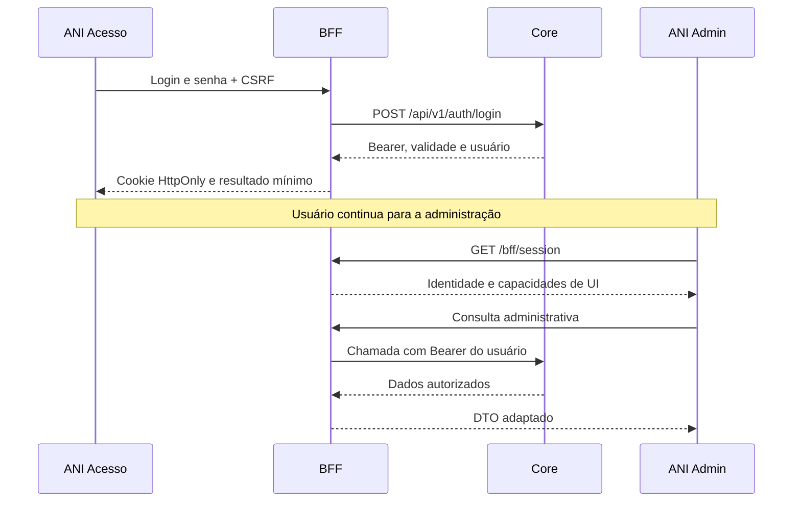

# ANI · Front-end e BFF

Workspace com duas aplicações Angular e um BFF Node.js/TypeScript. O fluxo atual é **login/senha → BFF → Core**, com token no servidor e sessão opaca no navegador.

> O modo integrado é local, conectado ao QA autorizado. Sistemas já têm listagem via API; solicitações e relatórios reais continuam pendentes. A entrega ainda não está pronta para produção.

## Experiências e responsabilidades

| Aplicação | Papel | Porta |
|---|---|---|
| `ani-login` | Login, sessão, recuperação de senha e cadastro público opt-in | 4201 |
| `ani-admin` | Administração de usuários, sistemas, perfis, permissões, solicitações, auditoria, relatórios e perfil próprio | 4200 |
| BFF | Sessão, CSRF, validação e comunicação com o Core | 3333 |

Ambos os apps chamam `/bff` por proxy local. O navegador não chama o Core diretamente. O cookie de sessão é compartilhado pelo fluxo local; estado de interface e serviços pertencem a cada aplicação.

No `ani-admin`, **Meu Perfil** consulta `GET /usuarios/{guid}` usando o GUID da sessão autenticada. A troca de senha encaminha somente as senhas ao BFF; o BFF obtém os identificadores do mesmo registro e chama `POST /api/v1/auth/trocar-senha` com a autorização da sessão. A operação respeita `ANI_BFF_ENABLE_WRITES`, desabilitado por padrão na configuração local.

A aba **Acessos** usa `GET /bff/api/v1/me/acessos`, que consulta `/usuarios/{guid}/perfis` e `/usuarios/{guid}/permissoes-efetivas` sempre com o GUID da sessão. Se o Core responder 403/404, o BFF devolve somente os dados da própria sessão (`origem: "sessao"`). A tela fica no componente standalone `ani-meu-perfil` (`apps/ani-admin/src/app/features/meu-perfil`). Ele recebe os dados pelo contrato `MY_ACCOUNT_API`, o que permite reutilizá-lo em outros sistemas com outro adaptador.

No **Novo cadastro** administrativo de usuários, o código atual define a senha inicial no BFF: primeiro nome em minúsculas seguido de `1234`. O navegador não escolhe nem recebe essa senha. Essa regra é previsível e não deve ser tratada como política aprovada para produção; o front-end não obriga troca no primeiro acesso e o comportamento do Core ainda precisa ser confirmado. Cadastro bem-sucedido não comprova login: validar o login gravado, o status e a autenticação em ambiente autorizado. Quando a API rejeita um cadastro, o BFF repassa somente nomes de campos permitidos, sem valores nem mensagens brutas da API.

Para conceder acesso, abra o detalhe do usuário e atribua um perfil ativo do sistema desejado. Esse perfil precisa ter as permissões adequadas. Cadastro, definição de credenciais e concessão de acesso são etapas distintas; não há assistente que execute toda a jornada automaticamente. O cadastro público usa e-mail como login, mas a aceitação desse formato pelo Core deve ser homologada.

## Estrutura implementada

```text
apps/
├── ani-login/src/app/
│   ├── core/
│   │   ├── login.service.ts            # Contexto, login, sessão e logout
│   │   └── user-registration.service.ts # Cadastro público direto, quando habilitado
│   └── app.{ts,html,scss}              # Telas e estado da experiência de acesso
└── ani-admin/src/app/
    ├── core/
    │   ├── api/admin-api.service.ts    # Cliente HTTP do BFF
    │   └── auth/                      # Sessão, guarda e armazenamento CSRF
    ├── features/meu-perfil/            # Componente standalone e contrato MY_ACCOUNT_API
    └── app.{ts,html,scss}              # Shell, navegação e demais telas administrativas
libs/
├── api-contracts/src/index.ts          # Tipos compartilhados
└── design-tokens/src/theme.scss        # Tokens visuais
bff/ani-admin/src/
├── api-server.ts                       # Servidor integrado e rotas permitidas
├── core-client.ts                      # Transporte HTTP para o Core
├── core-login.ts                       # Login e validação do retorno
├── login-routes.ts                     # Ciclo de sessão e login
├── authorization.ts                    # Capacidades da interface
├── contracts.ts                        # Validação e projeção dos DTOs
├── mock-access-report.ts               # Relatório sintético identificado
└── server.ts                           # Servidor da demonstração isolada
```

### Escolhas do front-end

- **Angular standalone e TypeScript:** dois projetos no mesmo workspace, com configuração e builds próprios.
- **Serviços por aplicação:** `HttpClient` concentra o acesso ao BFF; as telas não recebem Bearer tokens.
- **Tipos compartilhados:** `libs/api-contracts` define contratos em evolução; não são clientes gerados de um OpenAPI completo.
- **SCSS e tokens semânticos:** base visual comum para acesso e administração.
- **Responsividade:** sidebar no desktop, menu móvel com backdrop e Escape, tabelas convertidas em cartões e formulários adaptáveis.
- **Estados explícitos:** carregamento, erro e ausência de registros são distintos; o relatório demonstrativo tem identificação própria.

As demais telas ainda estão concentradas nos componentes raiz; Meu Perfil já foi extraído. Extrair shell, componentes de apresentação e outras features por domínio é uma evolução a planejar. `app.routes.ts` está vazio nos dois apps; não há rotas por domínio implementadas. As estruturas propostas nos documentos de arquitetura não representam integralmente a árvore atual.

## Executar com a API

Requisitos: Node.js **>=24.15 e <25**, npm **11+**.

Neste diretório:

```bash
npm ci
cp bff/ani-admin/.env.example bff/ani-admin/.env.local
```

Edite `.env.local` com a origem HTTPS autorizada ou com a origem local do Core em `ANI_CORE_BASE_URL`, conforme [conexão com o Core](docs/conexao-core.md). A origem local `http://localhost:5146` é específica para desenvolvimento; essa configuração altera o destino de todas as chamadas Core do BFF. O arquivo configura os destinos locais dos apps e mantém `ANI_BFF_ENABLE_WRITES=false`. Não coloque credenciais no código nem comite esse arquivo.

Abra três terminais neste diretório:

```bash
npm run bff:api
```

```bash
npm run start:login
```

```bash
npm run start:admin
```

1. Acesse http://127.0.0.1:4200.
2. Sem sessão, o Admin encaminha a http://127.0.0.1:4201.
3. Informe as credenciais sintéticas autorizadas para QA.
4. Após sucesso, clique em **Continuar para administração**.
5. **Sair** encerra a sessão e retorna ao Login.

Não é necessário iniciar os mocks nesse fluxo. Reinicie o BFF após alterar sua configuração. Não há chave de integração local na entrada do Admin.

## Fluxo de autenticação



O perfil `Administrador` confirmado pelo Core libera leitura/navegação em todas as áreas. Não é inferido pelo nome da pessoa. Escritas exigem permissão explícita e habilitação no BFF; a API continua responsável por autorizar cada operação.

**Pendência de autorização (2026-11-01):** foi solicitado acesso total para Administrador, mas esta entrega não altera a regra. Sistemas, Perfis e Permissões exigem `catalog.write`; Usuários exige `users.write` (também mapeado de `usuarios.manage`). Sem a capacidade, Novo cadastro e Editar ficam ocultos e o BFF recusa a escrita. `ANI_BFF_ENABLE_WRITES=true` não concede permissões. Confirmar com o Core o administrador global, o escopo por sistema e os códigos de permissão antes de modificar o mapeamento; após mudanças de permissões, renovar o login.

## Integração e limites funcionais

| Área | Implementação e limite |
|---|---|
| Autenticação | Login válido/inválido, sessão e logout exercitados no QA autorizado |
| Usuários | Listagem integrada; normalização de paginação `totalItems` e status |
| Meu Perfil | Meus dados, Acessos e Trocar senha; identidade derivada da sessão. Componentização e testes locais não comprovam troca real de senha |
| Perfis e permissões | Rotas de consulta e escrita implementadas; homologação dos fluxos pendente |
| Auditoria | Rotas de consulta implementadas; validação funcional completa pendente |
| Sistemas | Listagem, detalhe, criação e edição integrados via `/api/v1/sistemas`; escrita depende de `catalog.write` e `ANI_BFF_ENABLE_WRITES=true`. DELETE permanece bloqueado até confirmar semântica |
| Cadastro público | `POST /api/v1/usuarios`, opt-in por `ANI_BFF_ENABLE_PUBLIC_REGISTRATION`; login igual ao e-mail, senha escolhida pela pessoa e sem conceder acesso a sistemas |
| Fila e decisão de acesso | Endpoints de solicitação/aprovação ausentes; não estão disponíveis na integração Core |
| Relatórios | Mock explícito com três registros sintéticos e CSV identificado |
| Escritas | Desabilitadas por padrão no exemplo; habilitação local não é aprovação para produção nem evidência de sucesso remoto |

Não existe fallback geral para mocks quando o Core falha. A exceção específica de `/me/acessos` usa as informações da própria sessão para 403/404 e identifica a origem; demais falhas não viram sucesso. Cadastro público cria uma conta sem associação de sistema/perfil e requer habilitação explícita, separada das escritas administrativas. A fila/aprovação ainda não tem endpoint no contrato. O contrato de sistemas está salvo em [OpenAPI ANI Core v1](docs/ani-core-openapi-v1.json). A inativação está bloqueada na UI integrada até confirmar se DELETE representa exclusão física ou inativação lógica; rotas DELETE de vínculos não equivalem a excluir a conta.

## Segurança e fronteira de produção

O BFF aplica allowlist de métodos e rotas, validação de DTOs, origens e Host, CSRF, limites de requisição e concorrência, timeout, bloqueio de redirects e projeção de respostas. O Bearer fica em memória no servidor; o navegador usa cookie `HttpOnly`, `SameSite=Strict`, com expiração e encerramento no logout. Erros não repassam corpos sensíveis do Core.

A execução é restrita a `development/test` e loopback. O cookie sem `Secure` atende somente HTTP local. Produção requer revisão de identidade, autorização e auditoria do Core, sessão compartilhada, HTTPS, cookies seguros, limites distribuídos e infraestrutura aprovada. Cognito/OIDC é uma proposta documentada, não o mecanismo em execução.

## Demonstração isolada

Para explorar a demonstração sintética, inicie os serviços abaixo **no lugar de `bff:api`**, além dos dois apps Angular:

```bash
npm run local:core
npm run local:idp
npm run local:bff
```

Core mock utiliza a porta 3334; IdP mock, 3335; BFF mock, 3333. Os dados são voláteis em memória. O fluxo simulado de identidade do Admin é separado do login/senha integrado; o endpoint de login de usuário não está disponível nesse modo. Aprovação mock altera status e não provisiona usuário real.

## Comandos de desenvolvimento

| Comando | Finalidade |
|---|---|
| `npm run start:admin` | Admin em 4200 |
| `npm run start:login` | Acesso em 4201 |
| `npm run bff:api` | BFF integrado em 3333 |
| `npm run build:admin` / `npm run build:login` | Build de produção de cada app |
| `npm run build` | Build de produção dos dois apps |
| `npx ng test ani-admin --watch=false` / `npx ng test ani-login --watch=false` | Testes Angular sem modo watch |
| `npm --prefix bff/ani-admin test` | Testes BFF com serviços sintéticos locais |

**Limitação conhecida:** o build de produção do Admin excede o orçamento CSS de `app.scss` (limite de `12 kB`). O limite não foi aumentado. Esse bloqueio e as pendências funcionais precisam ser resolvidos antes do release. Consulte [continuidade](docs/continuidade-2026-11-01.md) para as verificações desta entrega.

## Próximos passos para V1

1. Completar contratos de resposta e erros do Core e validar adaptadores por domínio.
2. Disponibilizar endpoints de solicitações/aprovação e relatório real.
3. Definir provisionamento, duplicidade, verificação de e-mail e semântica de inativação.
4. Validar escritas autorizadas, permissões, sessão e cenários de falha com dados sintéticos.
5. Resolver orçamento CSS, revisar acessibilidade e concluir QA responsivo.
6. Planejar extração de componentes e features sem alterar as regras de acesso.
7. Confirmar administrador global e códigos de escrita com o Core; homologar cadastro → login → atribuição de perfil → troca de senha, sem presumir sucesso a partir do cadastro.

## Leituras de apoio

- [Conexão ao Core e contrato BFF](docs/conexao-core.md)
- [Levantamento V1 de login ponta a ponta](docs/v1-login-ponta-a-ponta.md)
- [Arquitetura UI e design system](docs/arquitetura-ui-design-system.md)
- [Prontidão V1](docs/prontidao-v1.md)
- [Arquitetura geral e propostas](../docs/arquitetura-ani.md)
- [Segurança e limites](../seguranca/README.md)

Os documentos de arquitetura incluem propostas e registros históricos. Este guia descreve a estrutura executável atual; contratos, infraestrutura e funcionalidades pendentes não são apresentados como homologados.
