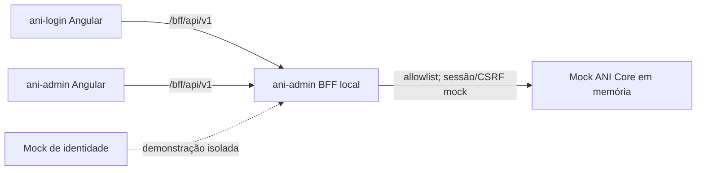

# Análise de integração ANI Core API — 2026-10-31

## Escopo e fonte

Esta análise compara o workspace `front-end/` com a definição OpenAPI v1 servida pelo Swagger informado pelo responsável da API. Foi lido somente o documento Swagger/OpenAPI; não foram executadas operações de API nem enviados dados. O endereço consultado é um ambiente remoto cuja classificação (desenvolvimento/QA/produção), autenticação e estabilidade não foram confirmadas.

O documento se refere ao que o OpenAPI **declara**, não comprova comportamento, controles de autorização, persistência, configuração de ambiente ou funcionamento dos endpoints.

## Arquitetura encontrada no workspace

- `ani-login` e `ani-admin` são apps Angular independentes. O browser não deve chamar o Core diretamente.
- `bff/ani-admin` é um BFF Node.js local, com allowlist e sessão mock. Atualmente encaminha ao `mock-ani-core`; não foi preparado para apontar para a URL entregue.
- `mock-ani-core` mantém fixtures sintéticas em memória. `mock-identity-provider` é demonstração, não integração OIDC real.
- `libs/api-contracts` contém tipos candidatos. `AdminApiService` modela paginação `{items,total,page,pageSize}` e rotas agregadas sob `/api/v1`; precisa ser ajustado ou adaptado ao contrato aprovado.
- O workspace não tem Git próprio visível nesta pasta e o `git status` não pôde ser consultado por causa do bloqueio local do Xcode; nenhuma alteração de código foi feita nesta análise.

## Rotas no OpenAPI versus necessidades da UI

| Domínio | Declarado no OpenAPI | Necessidade atual do front | Situação |
|---|---|---|---|
| Usuários | CRUD, perfis atribuídos/removidos e permissões efetivas | CRUD, lista/detalhe, associação de perfis e detalhe de permissões | Correspondência funcional aparente; alinhar DTOs, filtros, paginação e envelope de resposta |
| Perfis | CRUD, consulta/associação/remoção de permissões | CRUD, detalhe, associação de permissões | Correspondência aparente; o modelo UI inclui `sistemaId` e lista de permissões em `AniProfile`, ausentes nos requests publicados |
| Permissões | CRUD | CRUD e associação a perfis | Correspondência aparente; schema de criação também inclui `codigo`, `descricao`, `dscUrl`, `ativo` |
| Auditoria | listagem filtrável e detalhe por GUID | listagem, filtros e detalhes | Parcial; API lista filtros específicos, mas não documenta resposta; conferir campos e paginação |
| Autenticação | `POST /api/v1/auth/validar-credenciais`, `POST /api/v1/auth/login` e também `POST /api/auth/login` | BFF espera `/session`, `/auth/login` (redirect), `/auth/logout` e cenário dev local | Não há contrato suficiente para ligar; login por senha não define sessão, MFA, tokens, revogação, autorização ou fluxo OIDC |
| Solicitações de acesso | Não aparece | Catálogo público `/portais`, criar/listar/detalhar e aprovar/rejeitar solicitações | Bloqueio funcional; contrato Core precisa fornecer rotas/decisão ou outro serviço aprovado |
| Portais/sistemas | Não aparece | `/portais` ativos para seletor da solicitação | Bloqueio para solicitação pública; não mapear como perfis sem decisão explícita |
| Relatórios de acesso | Não aparece | `GET /relatorios/acessos` | Gap; confirmar se fica no Core, em consulta derivada autorizada ou fora do V1 |

## Divergências concretas a alinhar

1. **Prefixo do BFF:** o Angular chama `GET/POST /bff/api/v1/{recurso}`. O OpenAPI expõe `/api/v1/...`; o BFF deve mapear explicitamente cada rota permitida e não fazer proxy genérico.
2. **Identificadores:** OpenAPI usa `guid` em path com formato UUID. A UI trata `id` como string opaca. Confirmar serialização UUID e se a resposta chama o campo `id`, `guid` ou outro nome.
3. **Paginação e filtros:** OpenAPI de usuários declara `Busca`, `Status`, `PerfilGuid`, `PageNumber`, `PageSize`; Angular envia `page`, `pageSize`, `search`, `status` e normaliza `{items,total,page,pageSize}`. Auditoria declara filtros próprios e `PageNumber/PageSize`; perfis/permissões somente declaram `apenasAtivos/apenasAtivas`, sem paginação/documentação de busca.
4. **DTO de usuários:** `UsuarioCreateRequest` declara `nome`, `login`, `email`, `senha`, `status`; atualização não declara `login` nem `senha`. A UI usa nome/email/login/status, mas o fluxo administrativo não deve tratar senha sem regra aprovada. A solicitação pública atual também pede dados que não têm rota/schema no Core.
5. **DTO de perfil:** requests de perfil declaram nome, descrição e `ativo`; a UI requer `sistemaId` e exibe nome do sistema. Confirmar se sistema faz parte do contrato real ou se o modelo local é provisório.
6. **DTO de permissões:** criação declara `codigo`, `nome`, `descricao`, `recurso`, `acao`, `dscUrl`, `ativo`; atualização não declara `codigo`. O modelo TS local não representa todos esses campos e usa `status` em vez de `ativo`.
7. **Envelope e respostas:** a definição retorna apenas descrição `200 OK`, sem schema de resposta, códigos de erro, validação, conflito, não encontrado ou sem conteúdo. Não é possível gerar cliente confiável nem definir estados de UI a partir do documento atual.
8. **Semântica de DELETE:** rotas são `DELETE`, mas o contrato não esclarece exclusão física/lógica, dependências, conflito ou resposta. A UI chama a operação de inativação lógica; isso precisa ser confirmado com o analista.
9. **Contrato de segurança:** a definição exibida não declara `securitySchemes` nem requisitos de segurança por operação. Isso não prova que os endpoints sejam anônimos; significa que autenticação/autorização não estão documentadas no OpenAPI consultado. Confirmar mecanismo, papéis/escopos e se o Core recebe identidade do operador pelo BFF.
10. **Autenticação duplicada:** existem dois caminhos de login, um fora de `/api/v1`; confirmar se são aliases temporários, qual é o canônico e se algum valida credenciais sem estabelecer sessão. Não enviar credenciais para sondar.

## Recomendação de próxima fatia

Antes de conectar, pedir ao responsável da API:

- OpenAPI versionado e completo, com schemas de resposta e erro, paginação/filtros, formatos de datas/enums e exemplos sintéticos;
- URL e classificação do ambiente autorizado para integração/QA, método de autenticação servidor-servidor e instruções locais;
- confirmação de rotas canônicas e comportamento de `DELETE`;
- contrato de identidade/sessão e propagação confiável do operador/ator de auditoria; esclarecer as rotas de login existentes sem tratar login/senha como OIDC;
- endpoints e regras de catálogo, solicitação, aprovação/provisionamento e relatório, ou confirmação formal de que esses fluxos saem do escopo V1;
- autorização por operação/escopo e comportamento esperado para 401, 403, validação, conflito, paginação excessiva, indisponibilidade e timeouts.

Depois do alinhamento, gerar/validar tipos a partir do OpenAPI aprovado, implementar cliente servidor-a-servidor no BFF com allowlist, e adequar mock e telas ao mesmo contrato. Fazer primeiro integração em ambiente não produtivo autorizado com dados sintéticos. Não apontar o workspace local à URL atual até a classificação e autorização do ambiente serem confirmadas.

## Parecer de prontidão

- **Pronto para QA exploratório do front/mock:** conforme documentação anterior, sujeito a confirmar build de produção e preparar ambiente limpo de QA.
- **Pronto para QA integrado com a API recebida:** ainda não. Há correspondência parcial de domínios, mas diferenças de DTO/filtros, respostas não descritas, auth indeterminada e três áreas de UI sem rotas documentadas (solicitações, catálogo e relatórios).
- **Pronto para produção:** não é possível concluir pelo Swagger. Esta análise não avaliou implementação, autorização efetiva, dados, rede, persistência, monitoramento nem segurança operacional.

