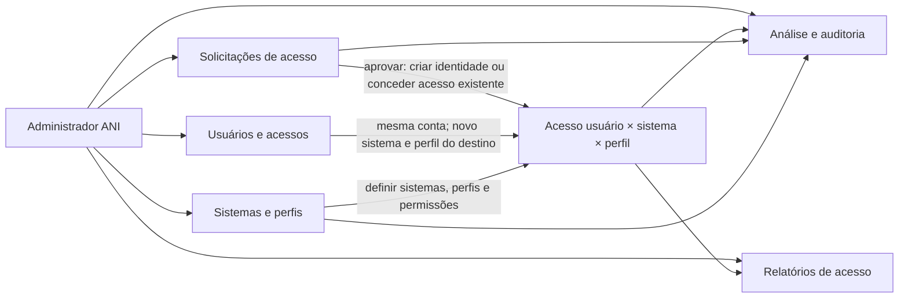
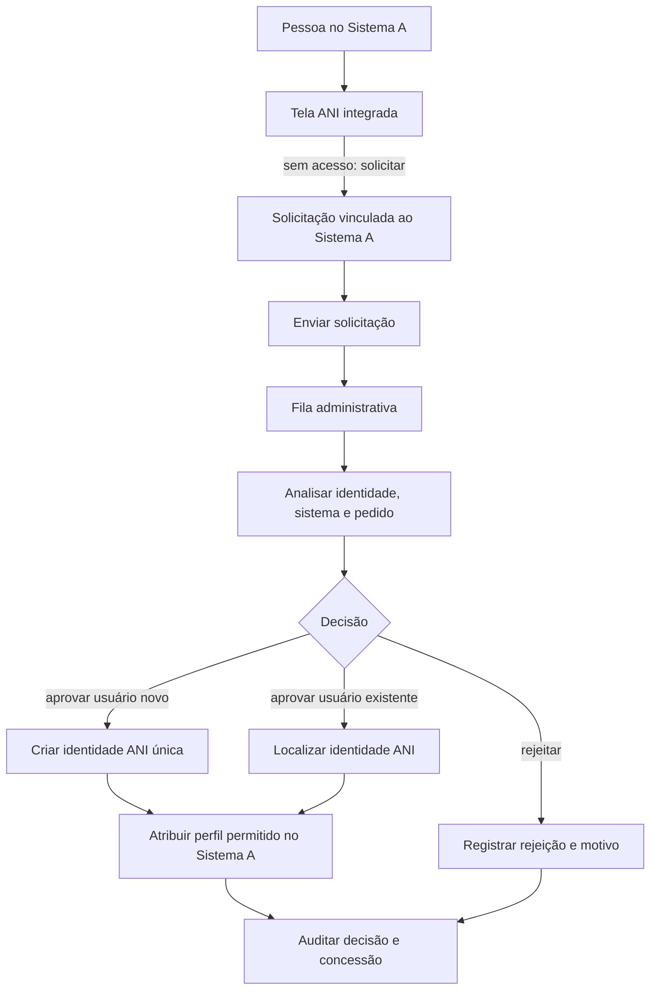
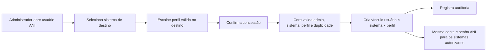

# Fluxos administrativos ANI

**Estado:** mapa funcional inicial e wireframes em discussão. Os exemplos usam nomes fictícios. A matriz de autorização, campos, status e APIs administrativas ainda precisam de aprovação.

## Implementação atual — 2026-11-01

As propostas abaixo não substituem o fluxo executável descrito no [README](../README.md):

1. Preparar sistema, perfil ativo daquele sistema e permissões associadas.
2. Em Usuários → Novo cadastro, informar nome, e-mail, login e status. O BFF atual define a senha inicial por primeiro nome em minúsculas + `1234`; regra previsível, sem garantia de troca obrigatória e não aprovada para produção.
3. Abrir o detalhe do usuário e usar **Atribuir acesso** para associar o perfil. Cadastro não concede acesso automaticamente.
4. Homologar login com a conta ativa; em caso de recusa, confirmar dados gravados e regras de credenciais no Core. Não concluir que falta de perfil é a causa de um 401.
5. Em Meu Perfil, consultar **Meus dados**, **Acessos** e **Trocar senha**. A troca é encaminhada à API com identidade da própria sessão.

Novo cadastro/Editar de Sistemas, Perfis e Permissões exigem `catalog.write`; Usuários exige `users.write`. O perfil Administrador concede navegação e consultas no BFF atual, não todas as escritas. Acesso total de administrador global foi solicitado, mas permanece pendente de definição de escopo e códigos no Core. Nenhuma mudança de autorização integra esta entrega.

CRUD de sistemas e vínculos de perfis/permissões já têm adaptação local. Solicitações/aprovações reais continuam sem endpoint; relatórios são demonstrativos explícitos. A inativação da UI integrada permanece bloqueada até confirmar a semântica de DELETE. As tabelas seguintes são o levantamento inicial, não a cobertura atual homologada.

## Princípios do modelo

- Uma pessoa possui uma identidade ANI e um único conjunto de credenciais.
- O acesso é atribuído por sistema: uma pessoa pode ter acesso ao Sistema A, ao Sistema B ou a ambos, com perfis diferentes em cada sistema.
- “Copiar acesso para outro sistema” significa conceder acesso à mesma conta ANI no sistema de destino. Não criar outra conta nem copiar senha.
- O administrador escolhe um perfil válido no sistema de destino; não assumir que um perfil de origem tem permissões equivalentes no destino.
- **Regra ainda pendente:** uma aprovação pode futuramente provisionar identidade e conceder perfil/acesso, conforme política aprovada. A solicitação por si só não concede acesso. No mock atual, aprovar/rejeitar altera somente o estado da solicitação; não cria usuário nem perfil.

## Mapa geral de navegação

## Fluxo de solicitação de acesso — proposta de negócio

O mapa abaixo descreve uma proposta para discussão, não o comportamento implementado nem uma regra aprovada. É preciso decidir se aprovação cria identidade e concede acesso, ou se registra apenas uma decisão que será seguida por outro processo.

Pendente: decidir se aprovação cria usuário e acesso inicial juntos, ou se uma solicitação pode conceder acesso adicional a usuário já existente. O fluxo não deve duplicar login/senha.

## Fluxo para conceder acesso a outra aplicação

## Fluxos por área administrativa

### Recepção e aprovação de solicitações

1. Consultar fila pendente, filtrada por sistema, status e data.
2. Abrir solicitação e revisar nome, e-mail de contato, sistema identificado pela aplicação de origem e justificativa, quando coletada.
3. Localizar usuário ANI existente para evitar duplicidade.
4. Aprovar ou rejeitar; para aprovação, definir/criar identidade e selecionar perfil disponível no sistema de destino, conforme política aprovada.
5. Registrar ator, decisão, horário, sistema, perfil concedido e justificativa administrativa na auditoria.

### Cadastro de sistemas e perfis

1. Registrar sistema consumidor com identificador único, nome e status.
2. Configurar os parâmetros de integração que o protocolo escolhido exigir (origens/retornos/clientes), com acesso restrito.
3. Criar perfis dentro do escopo de um sistema.
4. Associar permissões definidas pela área responsável ao perfil do sistema.
5. Ativar/desativar catálogo sem apagar concessões e trilha histórica.

### Usuários e acessos

1. Localizar uma identidade ANI global.
2. Ver acessos concedidos por sistema e perfil.
3. Conceder novo acesso selecionando sistema de destino e perfil daquele sistema.
4. Revogar o vínculo com sistema sem excluir a identidade global.
5. Auditar concessões e revogações.

### Análise e auditoria

1. Pesquisar eventos por data, sistema, usuário, ator, ação e resultado, conforme política de acesso.
2. Abrir o evento para consultar contexto permitido e correlação.
3. Não exibir nem registrar senha, hash, token ou segredo.

### Relatórios de acesso

1. Selecionar sistema e filtros aprovados (perfil, status, usuário e período).
2. Exibir usuários com acesso e perfil vigente naquele sistema.
3. Permitir exportação somente após definir formato, autorização e proteção dos dados exportados.

## Endpoints: cobertura conhecida e lacunas

| Área | Situação |
|---|---|
| Solicitações | Candidatos já registrados: `POST/GET /api/v1/solicitacoes-cadastro`, `GET /{id}`, `POST /{id}/aprovar`, `POST /{id}/rejeitar` |
| Usuários/perfis/permissões | Rotas CRUD e vínculos estão listados no contrato candidato, mas precisam de escopo por sistema |
| Sistemas | CRUD ainda não definido; necessário para cadastro e gestão de consumidores |
| Conceder acesso de usuário a outro sistema | O contrato atual de `usuarios/{id}/perfis` não explicita o sistema; definir rota/payload de concessão usuário × sistema × perfil |
| Auditoria | `GET /api/v1/auditoria` e `GET /api/v1/auditoria/{id}` são candidatos; fechar filtros/campos e permissões |
| Relatórios | Endpoint específico de relatório ainda não existe; definir contrato, filtros, volume e exportação |
| Login multiaplicação | Protocolo e APIs de autenticação/retorno ainda precisam de decisão |

As tabelas de aplicação, acesso por usuário/sistema e perfil escopado por sistema também precisam entrar no modelo de dados antes de fechar o SQL.
