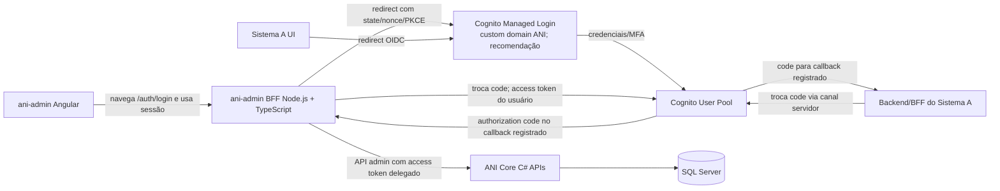

# Arquitetura de acesso às APIs ANI

**Atualização de implementação (2026-11-01):** o modo executável já usa login por credenciais → BFF → Core, com token no servidor, sessão e CSRF; mocks seguem isolados. Meu Perfil tem rotas próprias de leitura, acessos e troca de senha com identidade derivada da sessão. Acesso total para Administrador continua pendente de escopo/códigos no Core; esta entrega mantém a autorização vigente. Consulte [conexão ao Core](conexao-core.md) e [README](../README.md). As descrições mock-only abaixo são históricas e os diagramas OIDC/Cognito continuam propostas, não decisões aprovadas.

## Estado informado

- Outro analista está desenvolvendo o ANI Core/API em C# com base nos endpoints previamente sugeridos. Este workstream prepara o BFF/front-end; deve consumir o OpenAPI e instruções locais que o analista disponibilizar, sem presumir que rotas/payloads já estejam implantados.
- O workspace `front-end/` agora contém um protótipo local do BFF Node.js + TypeScript e um mock HTTP do Core; ambos usam dados sintéticos em memória e não implementam OIDC nem chamam serviços remotos.
- O protocolo multiaplicação de login, retorno de autenticação, sessão, logout e revogação ainda precisa de contrato próprio. Endpoints CRUD de usuário/perfil não constituem esse protocolo.

Consulte [Arquitetura proposta de identidade e integração](../../docs/arquitetura-identidade-integracao.md) para a recomendação AWS Cognito/OIDC, o fluxo do BFF, integração segura com Core e execução local no Codex. O ANI Core/API está sendo desenvolvido por outro analista; o BFF deve consumir o OpenAPI/endpoints que ele implementar, alinhados aos candidatos registrados, e não duplicar as regras nem criar contratos paralelos.

O estado prático da implementação, o conjunto de rotas provisórias cobertas pelo mock e os bloqueios para integração V1 estão em [Prontidão da V1](prontidao-v1.md). A URL e o mecanismo de autenticação do Core ainda não foram conectados; a implementação local é deliberadamente mock-only.

## Componentes e responsabilidades

| Componente | Tecnologia proposta | Responsabilidade |
|---|---|---|
| Cognito Managed Login (recomendação) | AWS Cognito User Pools + OIDC | Hospeda credenciais, MFA e recuperação. A tela é personalizável dentro de limites; não é um formulário Angular customizado. |
| `ani-login` (opcional) | Angular + TypeScript | Contexto ANI e solicitação de acesso; inicia/continua redirect OIDC. Não captura senha nem decide acesso. |
| ANI Core / APIs ANI | C# / ASP.NET Core (em desenvolvimento por outro analista) | Valida access token OIDC conforme contrato aprovado, mapeia `issuer + sub` para usuário ANI, autoriza cada endpoint/escopo e persiste via camada existente. Alinhar essa responsabilidade com o analista. |
| `ani-admin` | Angular + TypeScript | UI administrativa. Chama apenas seu BFF para sessão e operações administrativas; não guarda segredo privilegiado nem acessa SQL. |
| `ani-admin-bff` | Node.js + TypeScript | Protótipo local já criado em `front-end/bff/ani-admin/`: sessão mock, allowlist de rotas, CSRF e encaminhamento somente ao mock Core local. A versão de produção ainda precisa implementar o fluxo OIDC e adaptar-se ao OpenAPI real, sem duplicar a autoridade de autorização. |
| BFF de cada sistema externo | Tecnologia escolhida pelo próprio consumidor | Opcional conforme arquitetura do consumidor; mantém sua sessão e integra o ANI do lado servidor quando necessário. Não é fornecido automaticamente pelo BFF administrativo. |

O BFF é um serviço executado no servidor, separado do bundle Angular e separado da API C#. Proposta de diretório no repositório de implementação: `bff/ani-admin/`, com `package.json`, TypeScript, configuração e pipeline próprios. Para a primeira versão, usar Node.js + TypeScript; Fastify é uma opção enxuta para BFF pequeno, enquanto NestJS oferece mais estrutura se a equipe já o padronizar. Escolher com base nos padrões do repositório quando localizado; não criar um segundo framework sem necessidade.

### Estado do protótipo local

O workspace já implementa esse limite em modo mock: `ani-admin` chama o BFF local; o BFF aceita uma allowlist e encaminha apenas ao Core mock em loopback. O ANI Acesso busca o catálogo sintético de sistemas e envia solicitação ao mesmo BFF. O formulário visual de login ainda exibe campos de usuário/senha, mas não envia credenciais nem autentica; a arquitetura desejada continua sendo redirect ao IdP aprovado. Sessões, dados e rate limits do BFF mock são voláteis e não servem para produção. Métodos, rotas, payloads e erros precisam ser alinhados ao OpenAPI do analista do ANI Core.

O BFF pode ser implementado pelo workstream/time do front-end, pois acompanha as necessidades da UI e adapta seus contratos. O protótipo atual usa `node:http` nativo para reduzir dependências na execução local; framework e runtime de produção ainda precisam ser aprovados pela equipe. O time responsável pelo ANI Core deve definir e revisar o contrato de identidade, autorização e comunicação serviço-a-serviço. O proprietário operacional (deploy, alertas, patches e plantão) precisa ser nomeado pela organização; a escolha de quem codifica não define automaticamente quem opera.

Na AWS, implantar `ani-admin` estático separadamente (por exemplo, S3 + CloudFront, se aprovados) e executar `ani-admin-bff` como serviço de aplicação sem exposição direta (por exemplo, ECS/Fargate em sub-rede privada, atrás da borda aprovada). Para reduzir CORS e complexidade de cookies, publicar Angular e caminhos `/api/*` do BFF sob a mesma origem pública lógica, roteando pelo edge/reverse proxy; o BFF e Core permanecem em tarefas/rede privadas. A topologia exata e o limite de acesso administrativo (internet com controles adicionais, VPN ou rede corporativa) dependem de decisão. Não colocar segredos ou tokens de serviço em `environment.ts`, JavaScript ou arquivos baixados pelo browser. A credencial técnica do BFF não substitui a identidade delegada do operador nas chamadas ao Core.

## BFF comum ou um por sistema?

**Recomendação:** centralizar identidade no Cognito User Pool e autorização empresarial no ANI Core, mantendo um BFF por aplicação web que precisa de backend de apresentação/sessão. `ani-login` Angular pode ser uma página complementar de contexto/solicitação, não um IdP nem um formulário de senha. `ani-admin` terá seu `ani-admin-bff`; Sistema A poderá ter `sistema-a-bff`; Sistema B poderá ter `sistema-b-bff`.

Não criar um BFF ANI universal que mantenha sessão para todos os sistemas. Isso misturaria cookies, origens, permissões, versões de UI e necessidades operacionais de consumidores diferentes. Cada consumidor integra o serviço central ANI com credenciais/configuração próprias e continua responsável por autorizar suas operações locais. O BFF específico evita acoplamento da sessão administrativa às aplicações externas.

O protocolo de identidade e a API Core são centrais/reutilizáveis; o BFF e a sessão são específicos por consumidor. Um consumidor simples pode não precisar de BFF próprio se usar um cliente público e fluxo padrão apropriado, mas não pode guardar segredo no browser. A arquitetura adequada para cada consumidor precisa considerar se tem backend e como suas APIs verificam a sessão/resultado.



## Exemplo de fluxo do `ani-admin`

1. O Angular navega para `/auth/login` no `ani-admin-bff`; o Angular não implementa o cliente OIDC nem guarda o verifier. O BFF cria `state`, `nonce` e PKCE verifier exclusivos e os mantém ligados à transação.
2. O BFF redireciona o operador ao domínio ANI do Cognito usando o app client `ani-admin` e callback exato previamente cadastrado.
3. Cognito Managed Login coleta senha/MFA e autentica a identidade. O Core verifica a concessão do usuário ao sistema `ani-admin` nas chamadas administrativas; Cognito não substitui esta autorização.
4. Em sucesso, o protocolo retorna ao callback exato um authorization code curto, de uso único; não retorna senha, segredo de cliente ou access token no URL. Usar PKCE `S256`; validar `state`, `nonce` e issuer conforme o protocolo escolhido.
5. O callback do `ani-admin-bff` troca o código e valida o resultado com o ANI por canal servidor-a-servidor. A chamada seguinte ao Core representa o operador autenticado por mecanismo de delegação; o Core não pode depender de cabeçalhos de identidade definidos pelo browser.
6. O BFF cria uma sessão server-side (identificador opaco e revogável, com armazenamento apropriado para múltiplas instâncias) e entrega cookie host-only `HttpOnly`, `Secure`, `SameSite` deliberado e demais atributos endurecidos. O Angular não recebe token de serviço e não grava token em `localStorage`/`sessionStorage`. Mutação exige CSRF token/validação de origem; `SameSite` sozinho não basta.
7. O Angular consulta `/session` no BFF e recebe dados mínimos de identidade e capacidades efetivas de UI. O BFF/Core autorizam cada endpoint administrativo; guards e diretivas Angular servem apenas à navegação e apresentação.
8. Logout encerra a sessão local e executa o logout/revogação central definidos no contrato.

O fluxo acima é uma proposta de referência. Não presumir que os endpoints já existam na API implementada. Se o contrato ANI atual não oferecer protocolo compatível, serão necessárias novas operações na API C# antes de integrar o login. Expiração, renovação e armazenamento de sessão para múltiplas instâncias do BFF também precisam ser definidos.

## Chamadas Angular

No workspace atual, `apps/ani-login` e `apps/ani-admin` são aplicações Angular independentes, contratos candidatos ficam em `libs/api-contracts/`, tokens compartilhados em `libs/design-tokens/` e o proxy de desenvolvimento está em `proxy.conf.json`. Os comandos locais e limites estão no README do próprio workspace. A divisão Angular ainda é um protótipo de primeira fatia, não uma integração validada contra o ANI Core do outro analista.

Angular é TypeScript e usa `HttpClient` para chamar seu backend de aplicação. `ani-admin` chama URLs do `ani-admin-bff`; só o BFF chama APIs administrativas do Core. Use clientes/fachadas tipados por domínio, configuração de URL pública não sensível, correlation ID e normalização de erros. Gerar tipos/clientes a partir do OpenAPI revisado, sem criar modelos que divergem do servidor.

```text
ani-admin/src/app/core/
├── api/                 # HttpClient e fachadas para rotas do ani-admin-bff
├── auth/                # navega para /auth/login e consulta/finaliza sessão no BFF; sem cliente OIDC no browser
└── authorization/       # capacidades de interface baseadas na sessão do BFF

bff/ani-admin/src/
├── auth/                # início/callback/logout e integração com identidade ANI
├── session/             # criação, consulta, expiração e encerramento da sessão
├── ani-core/            # cliente servidor-a-servidor para ANI Core
├── routes/              # endpoints de apresentação consumidos pelo Angular
└── security/            # CSRF, cookies, validação e políticas de segurança
```

Nunca registrar credenciais, códigos, tokens, cookies/sessões ou dados pessoais desnecessários. Respeitar paginação e limites definidos no contrato. Não tratar erro ou indisponibilidade como autorização. Cada mutação e leitura protegida deve ser autorizada pelo servidor. O browser pode esconder funcionalidades sem permissão para melhorar a experiência, mas não substitui o controle no BFF/Core. O BFF deve expor endpoints explícitos e allowlisted, nunca um proxy curinga para qualquer URL/caminho do ANI Core.

## Decisões pendentes para integração

1. Obter do analista o OpenAPI atual, endpoints implementados e instruções de execução local da API C#.
2. Aprovar Cognito User Pools/Managed Login como IdP, OIDC Authorization Code + PKCE, clientes, callbacks, audience/issuer, scopes/claims e validação do resultado.
3. Usar redirect de nível superior para o domínio de autenticação ANI; não capturar senha em iframe/web component. Não aceitar origem/cliente fornecidos sem validação.
4. Definir sessão BFF: cookie, CSRF, expiração, renovação, revogação e armazenamento compatível com múltiplas instâncias.
5. Definir autenticação mútua BFF-Core, autorização por endpoint, time que implementa e proprietário operacional do BFF.
6. Definir BFF/backend e validação de sessão para cada consumidor sem backend próprio; nenhum consumidor deve confiar só nas permissões enviadas à UI.
7. Fechar OpenAPI separado para identidade/solicitação, sessão administrativa e operações de administração; versionar contrato e gerar clientes.

Use somente dados sintéticos nos exemplos. Esta documentação não autoriza chamadas a serviços reais, migração, publicação ou deploy.
