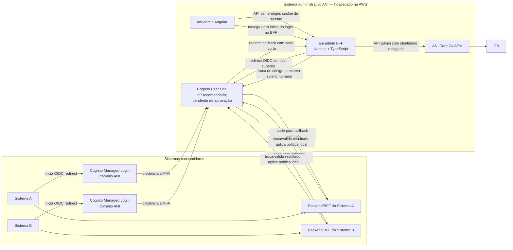

# Mapa de front-ends — ANI

**Entendimento atual:** o ANI tem duas experiências com públicos e funções diferentes. A recomendação de arquitetura continua sendo um provedor confiável via OIDC redirect; `ani-admin` é o portal Angular separado para manter cadastros, aprovações, perfis, permissões e auditoria. Cognito ainda depende de aprovação. **Protótipo visual atual:** `ani-login` mostra campos de login/senha e uma caixa antirobô para explorar a experiência básica, mas não autentica nem envia senha. Essa tela não aprova uma arquitetura de credencial própria nem substitui a definição do provedor.

**Implementação local atualizada em 2026-10-31:** o workspace `front-end/` contém os dois apps Angular, BFF local e Core/IdP mocks com dados sintéticos. A solicitação de acesso funciona até o Core mock e apresenta protocolo. A administração funciona contra os dados sintéticos. A UI está responsiva em desktop/celular; no Admin, o menu móvel substitui a sidebar e as tabelas viram cartões em telas estreitas. Isso demonstra UX e contratos candidatos, não a API C# ou autenticação reais. Veja [prontidão V1](prontidao-v1.md) e [continuidade para 2026-11-01](continuidade-2026-11-01.md).

Wireframes iniciais: [login ANI](wireframe-login.svg) e [solicitação de acesso](wireframe-solicitacao-acesso.svg).

## Arquitetura



Estado informado: outro analista está desenvolvendo a API ANI Core em C# com base nos endpoints levantados; o contrato implementado/OpenAPI ainda deve ser alinhado com este workstream. O BFF Node.js/TypeScript será desenvolvido separadamente para consumir essa API. Angular/TypeScript é o front-end. O diagrama é proposta, não comprovação de código ou infraestrutura.

## Fluxo 1: autenticação central ANI iniciada pelos sistemas consumidores

Responsabilidades do fluxo OIDC e das páginas ANI relacionadas:

- Iniciar OIDC por redirecionamento de nível superior para o domínio de autenticação controlado pelo ANI; com Cognito, a página que coleta credenciais é Managed Login.
- Identificar para qual aplicação a pessoa está solicitando acesso.
- Não coletar nem enviar senha a partir de um componente Angular customizado; o provedor OIDC selecionado coleta credenciais e aplica MFA.
- Exibir falha de autenticação ou ausência de acesso de forma segura.
- O provedor redireciona somente um authorization code curto, de uso único, ao callback registrado. O cliente valida o fluxo; não enviar tokens ou permissões em URL.
- Disponibilizar **Solicitar acesso** em uma página ANI separada (por exemplo, `ani-login` Angular). Não presumir que a página Cognito Managed Login permita incorporar esse CTA ou reproduzir o wireframe integralmente.

### Solicitação de acesso — campos mínimos propostos

- Sistema solicitado, apresentado como contexto do sistema que incorporou a tela (não como valor confiável escolhido livremente pelo navegador).
- Nome completo.
- E-mail para contato.
- Justificativa opcional, se as áreas aprovarem.

O envio cria uma solicitação pendente; não concede acesso automaticamente. A forma de verificar o solicitante, tratar duplicidade, confirmar e-mail e apresentar o resultado após envio ainda precisa de definição. A tela e o formulário de solicitação não coletam a senha.

O formato recomendado é redirect OIDC para Managed Login no domínio ANI, não formulário de senha em iframe ou DOM do consumidor. Recomenda-se Cognito User Pools com Authorization Code + PKCE `S256`, `state`/`nonce`, callbacks exatos e códigos de uso único. A decisão do provedor ainda está pendente. Não retornar tokens em URL nem considerar permissões exibidas no JavaScript prova suficiente; cada API protegida valida o token e autorização no servidor. Ver [arquitetura de identidade e integração](../../docs/arquitetura-identidade-integracao.md).

## Front-end 2: portal administrativo ANI

O portal Angular administrativo, hospedado na AWS, oferece telas para:

- Solicitar e aprovar cadastro de usuários.
- Manter usuários e seus perfis atribuídos.
- Manter perfis e permissões associadas.
- Consultar permissões efetivas de um usuário.
- Consultar eventos de auditoria.

O fluxo administrativo é `ani-admin Angular → ani-admin BFF (Node.js/TypeScript) → ANI Core C# → SQL Server`, com OIDC via Cognito Managed Login como recomendação. O browser não acessa o banco nem chama diretamente endpoints administrativos do Core. O BFF inicia/callback OIDC, valida o retorno no servidor, mantém a sessão do `ani-admin` e chama APIs do Core com access token do usuário. Ele não replica regras de negócio nem substitui autorização do Core.

O BFF fica em uma aplicação/serviço Node separado do projeto Angular, por exemplo `bff/ani-admin/`, com seu próprio `package.json`, configuração e pipeline. Na AWS ele é executado como serviço privado de aplicação (por exemplo, container ECS/Fargate), acessível pelo front-end via HTTPS e com acesso de rede ao ANI Core. O Angular conversa com o BFF pelo navegador usando TypeScript/`HttpClient`; a comunicação BFF-Core é feita pelo servidor, com autenticação serviço-a-serviço definida no desenho de segurança. Não colocar segredo cliente ou token privilegiado no bundle Angular.

Para sistemas externos, a proposta não é um BFF ANI universal compartilhado. Cognito é o serviço central de identidade e o ANI Core/API centraliza autorização ANI; `ani-login` Angular é opcional para solicitação de acesso/contexto. Cada consumidor mantém seu próprio backend/BFF quando precisa de sessão web, APIs privadas ou adaptação de contrato. Para o `ani-admin`, implementa-se o primeiro BFF consumidor, que servirá de exemplo. Se a intranet continuar sem backend, é cliente SPA público com Authorization Code + PKCE, sem segredo no browser; a API valida o access token e autoriza cada chamada.

### Sequência proposta para autenticação do `ani-admin`

1. O Angular navega para `/auth/login` no BFF. O BFF inicia o fluxo OIDC para o cliente `ani-admin`, cria `state`, `nonce` e PKCE verifier únicos e os mantém ligados à transação do browser.
2. O BFF redireciona o navegador ao domínio Cognito/ANI; identidade do cliente e callback vêm do registro OIDC, não de um parâmetro arbitrário.
3. Cognito Managed Login autentica a pessoa e aplica MFA conforme a política. O Core verifica a concessão ao cliente `ani-admin` em cada chamada administrativa.
4. Em sucesso, ANI redireciona apenas um authorization code curto, de uso único, para o callback exato do BFF; não expõe senha, segredo de cliente, token nem permissões em URL.
5. O BFF valida estado/issuer/cliente, troca o code por canal servidor-a-servidor usando PKCE e valida a resposta, incluindo audiência e nonce. O BFF estabelece sessão server-side revogável e entrega cookie endurecido; mutações exigem CSRF e validação de origem.
6. O Angular consulta a sessão do próprio BFF e recebe identidade e capacidades mínimas para a UI. O BFF passa contexto delegado do usuário ao Core; Core autoriza cada endpoint/ação. Guardas/diretivas organizam somente a experiência.
7. Logout encerra a sessão do portal e usa o fluxo de logout/revogação central que for definido.

Esta sequência é modelo de referência. Com Cognito, endpoints OIDC, autenticação e emissão de tokens pertencem ao provedor; não criar login proprietário no Core. O ANI Core deve validar access tokens Cognito e aplicar as permissões ANI em cada operação. O BFF mantém sessão server-side, encaminha o access token do usuário e não usa conta técnica genérica nem cabeçalho do browser como identidade. Definir armazenamento/expiração de sessão do BFF para múltiplas instâncias.

## Telas administrativas e APIs candidatas

| Tela | Rotas ANI Core candidatas |
|---|---|
| Solicitação de cadastro | `POST /api/v1/solicitacoes-cadastro` |
| Fila de aprovação | `GET /api/v1/solicitacoes-cadastro`, `GET /api/v1/solicitacoes-cadastro/{id}` |
| Aprovar/rejeitar | `POST /api/v1/solicitacoes-cadastro/{id}/aprovar`, `POST /api/v1/solicitacoes-cadastro/{id}/rejeitar` |
| Usuários | `GET/POST /api/v1/usuarios`, `GET/PUT/DELETE /api/v1/usuarios/{id}` |
| Perfis do usuário | `GET /api/v1/usuarios/{id}/perfis`, `POST /api/v1/usuarios/{id}/perfis`, `DELETE /api/v1/usuarios/{id}/perfis/{perfilId}` |
| Permissões efetivas | `GET /api/v1/usuarios/{id}/permissoes-efetivas` |
| Perfis | `GET/POST /api/v1/perfis`, `GET/PUT/DELETE /api/v1/perfis/{id}` |
| Permissões de perfil | `GET /api/v1/perfis/{id}/permissoes`, `POST /api/v1/perfis/{id}/permissoes`, `DELETE /api/v1/perfis/{id}/permissoes/{permissaoId}` |
| Catálogo de permissões | `GET/POST /api/v1/permissoes`, `GET/PUT/DELETE /api/v1/permissoes/{id}` |
| Auditoria | `GET /api/v1/auditoria`, `GET /api/v1/auditoria/{id}` |

As rotas de solicitação/aprovação são propostas novas e ainda precisam de aprovação. Os contratos de autenticação para os sistemas consumidores também não estão definidos pelos endpoints CRUD acima.

## Camada de integração com a API ANI

Em cada aplicação, a camada de acesso à API é código próprio do app Angular. Recomendação inicial: TypeScript com `HttpClient` do Angular, APIs standalone e interceptors funcionais; contratos TypeScript/clientes podem ser gerados a partir do OpenAPI aprovado. Não introduzir um SDK externo nem duplicar regras de negócio até o contrato e a necessidade estarem claros.

Se `ani-login` for mantido como app Angular, sua camada chama somente a API de solicitação de acesso. O fluxo de autenticação é OIDC com Cognito Managed Login (recomendação). No `ani-admin`, o navegador chama somente o BFF; o BFF chama o ANI Core. Nenhuma aplicação Angular acessa SQL Server nem contém segredo de cliente.

Estrutura recomendada dentro de cada app:

```text
apps/<ani-login|ani-admin>/src/app/core/
├── api/
│   ├── generated/             # tipos/clientes de OpenAPI, se aprovados
│   ├── api-config.ts          # URL base pública não sensível da API deste app
│   ├── api-error.ts           # normalização de erros para estado de interface
│   └── clients/               # fachadas tipadas por superfície/feature
├── auth/                      # ciclo de autenticação próprio deste app
└── http/
    ├── correlation-id.interceptor.ts
    └── error.interceptor.ts
```

O `ani-login` opcional e o `ani-admin` não compartilham contexto de sessão. A biblioteca opcional `libs/api-contracts` pode conter somente tipos/esquemas comuns gerados; clientes de transporte, interceptors, tokens e lógica de sessão permanecem dentro de cada app/BFF. Não persistir senha, token de acesso ou resultado de autenticação em `localStorage`/`sessionStorage`, não registrar credenciais ou dados pessoais e não tratar erro de rede como autorização.

Para controles e achados prioritários desta arquitetura, consulte a [revisão de arquitetura e segurança](revisao-arquitetura-seguranca.md). Ela registra riscos não resolvidos pela organização de pastas, incluindo confiança no retorno, preservação do usuário entre BFF e Core, revogação, exposição das rotas administrativas, MFA e tentativas de escalada de privilégio.

O mecanismo concreto de credenciais, retorno e sessão segue pendente. Recomenda-se avaliar OIDC/OAuth 2.0 para integração multiaplicação; não inventar protocolo próprio nem fixar formato de token até revisar o modelo de ameaça e aprovar o contrato. O navegador apenas apresenta o resultado. A autorização efetiva deve ser estabelecida/verificada pelo backend.

## Organização Angular sugerida

O login central e a administração têm públicos e ciclos distintos. Se adotado Cognito, o Managed Login é a tela de credenciais hospedada no domínio ANI; `ani-login` Angular pode permanecer como app de contexto/solicitação, sem capturar senha. O portal administrativo continua restrito a operadores: Cognito autentica e o ANI Core verifica a concessão ao `ani-admin` e autoriza cada ação. Não colocar rotas administrativas no bundle público de solicitação nem coletar senha em iframe/componente do consumidor.

### Resultado de autenticação e autorização dentro do `ani-admin`

O provedor de identidade ANI autentica a pessoa; o Core verifica o acesso para o cliente `ani-admin`. Conceitualmente, a sessão precisa identificar o sujeito e o cliente e permitir ao BFF consultar as capacidades efetivas concedidas naquele sistema. `Administrador` e `Operador 1` são exemplos para discutir a experiência, não regras de autorização nem contratos de claim; a matriz real de permissões precisa ser aprovada.

O retorno não deve ser aceito como um objeto arbitrário enviado pelo browser. Recomenda-se avaliar OIDC Authorization Code com PKCE e callbacks exatos; o `ani-admin-bff` valida/troca o resultado no servidor e estabelece uma sessão própria revogável. O Angular recebe do BFF apenas o estado e as capacidades mínimas necessárias à interface, sem access token. O Core deve receber do BFF o sujeito humano por delegação autenticada e autorizar cada ação; uma conta técnica genérica não deve apagar quem iniciou a operação. Protocolo e delegação ainda dependem de decisão e contrato aprovados.

No Angular do `ani-admin`, separar responsabilidades assim:

```text
ani-admin/src/app/core/
├── auth/
│   ├── admin-auth.facade.ts       # inicia login e consulta sessão atual no BFF
│   ├── admin-session.model.ts     # identidade e permissões efetivas tipadas
│   ├── auth-state.service.ts      # estado em memória; sem token em Web Storage
│   ├── auth.guard.ts              # experiência de rota; não substitui autorização server-side
│   └── permission.guard.ts        # UX para rota; não substitui autorização server-side
├── authorization/
│   ├── permission-catalog.ts      # códigos estáveis de capacidades do admin
│   ├── access-policy.service.ts   # consulta capacidades da sessão atual
│   └── can.directive.ts           # exibição condicional de controles na UI
└── api/                           # cliente do BFF; chamadas do browser não vão direto ao Core
```

O cliente de retorno faz o mapeamento de códigos estáveis de permissão para capacidades do `ani-admin`; não deve codificar nomes de perfil como regras de segurança espalhadas pelas telas. A API/BFF/Core continua aplicando a matriz autorizativa a cada operação, ainda que o menu, rota ou botão esteja oculto no Angular.

| Perfil ilustrativo no `ani-admin` | Capacidades de interface esperadas | Limite obrigatório |
|---|---|---|
| `Administrador` | Acesso às funções administrativas concedidas: solicitações, usuários, sistemas, perfis, permissões, auditoria e relatórios | O nome do perfil não concede acesso por si só; cada capacidade e endpoint exige autorização correspondente no servidor |
| `Operador 1` | Consultar lista/detalhe de usuários e visualizar apenas os dados liberados para consulta | Não criar, alterar, remover, aprovar/rejeitar, administrar perfis ou consultar dados fora do escopo concedido |

As capacidades acima são uma proposta para orientar a documentação e precisam ser confirmadas pelas áreas de negócio. Aplicar menor privilégio, especialmente em campos exibidos e filtros/escopos. Se houver várias atribuições, a API retorna as permissões efetivas para o sistema e escopos autorizados; a UI não calcula precedência ou união por conta própria. Negado, expirado, resposta inválida ou falha de rede deve manter a sessão sem acesso ou encerrá-la de forma segura, sem assumir `Administrador` como padrão.

O `ani-admin` será o exemplo de referência para os demais consumidores: documentar como iniciar o login identificando o cliente, receber/validar o resultado no backend, obter a sessão e permissões efetivas, mapear códigos a capacidades da aplicação e proteger telas e operações. A documentação de integração para chamadores deve conter o contrato versionado, sequência de redirecionamento/troca, validação de issuer/audience/cliente/expiração/nonce ou equivalente do protocolo aprovado, logout/revogação, tratamento de erros e exemplo de autorização UI versus API. Segredos, tokens reais e credenciais não entram no exemplo.

Para manter contratos e apresentação consistentes, pode haver uma biblioteca pequena compartilhada, sem estado de sessão ou regras de negócio. Ela pode conter tipos gerados a partir do OpenAPI aprovado, tokens de identidade visual e elementos visuais básicos. Cada aplicação mantém seus próprios clientes de API, configuração de segurança, roteamento e dependências. A biblioteca compartilhada não deve conter credenciais, lógica de autorização, armazenamento de sessão ou acoplamento a um fluxo específico.

```text
front-end/
├── apps/
│   ├── ani-login/                    # opcional; contexto/solicitação; credenciais no Cognito Managed Login
│   │   └── src/app/
│   │       ├── app.config.ts
│   │       ├── app.routes.ts
│   │       ├── core/
│   │       │   ├── api/              # HttpClient + fachada da API de solicitação de acesso
│   │       │   └── auth/             # início do redirect OIDC, sem formulário de senha próprio
│   │       └── features/
│   │           ├── login/
│   │           └── solicitacao-acesso/
│   └── ani-admin/                    # aplicação; consome ani-login para autenticar operadores
│       └── src/app/
│           ├── app.config.ts
│           ├── app.routes.ts
│           ├── core/
│           │   ├── api/              # HttpClient + fachadas tipadas para o BFF
│           │   ├── auth/             # chama /auth/login e consulta/encerra sessão no BFF; sem tokens OIDC no Angular
│           │   └── authorization/    # capacidades de UI mapeadas às permissões efetivas
│           ├── layout/               # shell, navegação e componentes do portal
│           └── features/
│               ├── solicitacoes/
│               ├── aprovacao-cadastro/
│               ├── usuarios/
│               ├── sistemas/
│               ├── perfis/
│               ├── permissoes/
│               ├── auditoria/
│               └── relatorios/
├── libs/
│   ├── api-contracts/                # tipos/clientes gerados do contrato aprovado
│   ├── design-tokens/                # tokens semânticos e temas compartilhados
│   ├── ui/                           # componentes de apresentação acessíveis
│   └── brand-assets/                 # logos/fontes/ícones aprovados
├── environments/                     # configuração pública não sensível por app/ambiente
└── docs/
```

Para detalhes sobre camadas visuais, organização de CSS, tokens, layouts e evolução de componentes, consulte [Arquitetura de UI e Sistema de Design](arquitetura-ui-design-system.md). A estrutura recomenda builds e releases independentes para os dois apps, mesmo que compartilhem um workspace Angular; `bff/ani-admin/` é serviço Node.js/TypeScript separado, fora do workspace Angular.

Os nomes representam uma organização proposta, não uma aplicação Angular já existente nem uma decisão sobre monorepo. O repositório oficial e a estratégia Angular ainda precisam ser confirmados. A biblioteca `api-contracts` só deve ser compartilhada onde o contrato realmente coincidir: as APIs de autenticação/solicitação e as APIs administrativas têm superfícies e controles diferentes. Tecnologia sugerida para as camadas HTTP: TypeScript e `HttpClient` do Angular, com clientes tipados gerados do OpenAPI aprovado quando disponível.

| Aspecto | `ani-login` | `ani-admin` |
|---|---|---|
| Público | Usuários finais dos sistemas consumidores | Operadores administrativos autorizados |
| Função | Cognito Managed Login hospeda autenticação; app `ani-login` opcional oferece contexto/pedido de acesso | Aprovar solicitações e manter usuários, sistemas, perfis, permissões, auditoria e relatórios |
| Autenticação | OIDC via Cognito recomendado; pedido de acesso não concede autorização | BFF inicia OIDC e mantém sessão server-side |
| API | API ANI para pedido de acesso; endpoints OIDC do provedor para autenticação | BFF administrativo → ANI Core; endpoints admin |
| Exposição | Domínio de autenticação ANI; consumidores iniciam redirect com callback cadastrado | Portal atrás da borda aprovada; rotas admin do Core não devem ficar anônimas nem abertas por causa do login |
| Configuração | Cliente registrado, callbacks exatos, PKCE e protocolo aprovados; sem segredos no bundle | URL do BFF e integração aprovada com `ani-login`; sessão própria, sem token em Web Storage |
| Release | Independente da administração | Independente do login incorporado |

Fluxo de entrada do portal: `operador → ani-admin Angular → ani-admin BFF inicia OIDC → Cognito Managed Login → callback code para BFF → troca/validação server-side → sessão admin → chamadas do BFF ao Core com access token do usuário`. A concessão de acesso ao `ani-admin` segue o cadastro de sistema e a associação usuário-perfil por sistema. O app client `ani-admin` deve ser registrado; a tela não concede acesso a si mesma.

Cada deploy deve configurar apenas a aplicação correspondente. A separação visual ou de rotas não é controle de acesso: autorização administrativa, validação do resultado de autenticação e proteção de cada operação permanecem no BFF/Core e nos backends consumidores, conforme o contrato aprovado. Se for adotado um único workspace Angular, manter projetos e bundles independentes e impedir que um app importe módulos do outro; isso não significa servir ambos pelo mesmo runtime público.

O BFF não faz parte do workspace Angular: é serviço servidor separado, proposto em `bff/ani-admin/` com Node.js/TypeScript. O Angular acessa suas rotas same-origin quando possível; o BFF chama Core em rede controlada e preserva o usuário autenticado por delegação validada. Nenhum bundle Angular guarda segredo de cliente/serviço.

## Decisões pendentes antes de implementar o login compartilhado

1. Decidir se Cognito User Pools/Managed Login é aprovado; se sim, usar redirect de nível superior para o domínio de autenticação ANI. Não incorporar captura de senha por iframe ou componente.
2. Se ANI adotará provedor de identidade gerenciado ou implementação OIDC madura e suportada; não criar protocolo próprio nos endpoints CRUD.
3. Aprovar OIDC/OAuth 2.0, Authorization Code + PKCE `S256`, callback exato, `state`/`nonce`, retorno e delegação do sujeito para cada backend.
4. Cadastro dos sistemas/clientes, identificação do sistema, permissões por sistema e matriz das áreas, incluindo perfis e capacidades do `ani-admin`.
5. Responsabilidade do backend de cada consumidor na validação do resultado e controle de cada operação; definir formalmente o contrato reutilizável de integração e não confiar em permissões da UI.
6. Como solicitação/aprovação cria usuário e atribui perfis iniciais.
7. Sessão BFF revogável, CSRF, MFA administrativa, expiração, logout, revogação e propagação de alteração de perfil.
8. OpenAPI das superfícies de identidade, solicitação e administração; autenticação BFF-Core; política de geração/versionamento de clientes TypeScript.

Ver [integração com API](integracao-api.md), [contrato candidato do Core](../../back-end/docs/contrato-api-inicial.md) e [decisões pendentes](../../docs/decisoes-e-pendencias.md).
