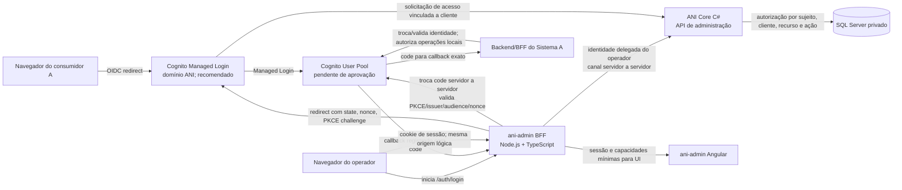

# Revisão de arquitetura e segurança — front-end e APIs ANI

**Nota de atualização (2026-11-01):** esta revisão é histórica e de desenho; não constitui auditoria das alterações atuais. O modo local agora integra login, cadastro/recuperação e Meu Perfil via BFF, conforme [README](../README.md). Administrador global e acesso total permanecem pendentes; nenhuma elevação de privilégios integra este pacote. A geração previsível de senha inicial existente no BFF exige revisão de política antes de produção. OIDC/Cognito segue proposta e os limites de produção continuam em aberto.

**Escopo:** revisão da arquitetura documentada para `ani-login`, `ani-admin`, BFF Node.js/TypeScript e API C# ANI Core. É uma revisão de desenho, não uma auditoria do código. O código-fonte da API e dos futuros serviços não está associado a este workspace; portanto, não foi possível verificar endpoints, configuração, controles efetivamente implantados ou testes.

**Conclusão:** a separação entre login central, portal administrativo e API Core é uma boa base. A arquitetura ainda não está pronta para implementar autenticação multiaplicação com segurança porque protocolo de identidade, retorno confiável, contexto do usuário entre BFF e Core, matriz de autorização, revogação e superfície de rede continuam sem contrato. Os wireframes e a estrutura Angular podem prosseguir como UX; não conecte credenciais ou operações privilegiadas antes de resolver os itens P0.

## Arquitetura de referência revisada



OIDC/OAuth 2.0 é a direção recomendada para validar como protocolo padrão, não uma decisão formal nem prova de que a API C# atual já fornece um authorization server. OIDC trata autenticação; OAuth trata autorização de API. Avaliar provedor gerenciado ou implementação OIDC madura e suportada. Não criar um protocolo de login/token próprio nem transformar endpoints CRUD em provedor de identidade por conveniência.

O desenho assume navegação de nível superior para uma página ANI hospedada na origem ANI. “Incorporado” deve significar que o consumidor inicia o fluxo e retorna à sua aplicação; não que um sistema arbitrário receba a senha digitada em um formulário executado no domínio dele. Iframe/web component que captura senha em origens de terceiros aumenta exposição a script host, clickjacking, roubo de credencial e dependência de cookies de terceiros. Só reabrir essa opção após um modelo de ameaça específico e controles de isolamento aprovados.

## Limites de confiança e ameaças prioritárias

| Limite | Tratar como não confiável | Controle que precisa existir no servidor |
|---|---|---|
| Sistema consumidor ↔ ANI | `client_id`, URL de retorno, parâmetros da tela, mensagens entre janelas e permissões no JavaScript podem ser manipulados | Registro de cliente, callback exato, `state`/`nonce`/PKCE vinculados à transação e validação da audiência |
| Browser ↔ `ani-admin-bff` | Todos os headers, corpo, query, navegação, cookie em mutações, ID de recurso e estado Angular | Sessão server-side, CSRF/origin, autenticação, validação de entrada, limites, autorização e proteção contra IDOR |
| `ani-admin-bff` ↔ ANI Core | Rede privada por si só não prova identidade nem ator | Autenticação de workload mais identidade do usuário delegada/validada; Core valida cada autorização e autoria |
| ANI Core ↔ SQL Server | Parâmetros e identificadores recebidos de camadas acima | Menor privilégio, consultas parametrizadas, transações e escopo aplicado no servidor; banco privado |

A revisão considera principalmente estes abusos: consumidor malicioso tentar reutilizar/redirecionar um código; usuário `Operador 1` chamar endpoints administrativos diretamente ou mudar IDs; invasor usar senha reutilizada/roubada contra o `ani-admin`; CSRF/XSS roubar sessão ou provocar mutações; BFF comprometido atuar como representante invisível de qualquer operador; e perfil removido continuar funcionando por claims/sessão obsoletos. O contrato, logging e testes devem demonstrar controles para cada cenário.

## Achados priorizados

| Prioridade | Lacuna/risco | Ajuste recomendado antes de integrar |
|---|---|---|
| **P0** | “Login e senha” foi informado, mas o contrato API em desenvolvimento lista principalmente endpoints de negócio. Ainda não há evidência local de authorization endpoint, troca de código, sessão, logout, MFA, recuperação ou proteção contra força bruta. | Aprovar Cognito User Pools/Managed Login (recomendação) ou outro IdP gerenciado; definir fluxos e responsabilidades. Core valida access tokens e não armazena senha se Cognito for escolhido. Configurar MFA, proteção contra abuso, rotação e resposta a incidentes antes de autenticação real. |
| **P0** | Formulário de senha embutido em sistemas chamadores pode executar sob origem não confiável e deixar o chamador inspecionar ou manipular a tela. | Hospedar a autenticação no Managed Login/IdP sob domínio ANI e usar redirect de nível superior com callback previamente cadastrado. `ani-login` Angular pode ser apenas página de contexto/solicitação. Iframe/web component que captura senha exige exceção arquitetural e modelo de ameaça próprio. |
| **P0** | O cliente/sistema e URL de retorno podem ser escolhidos/manipulados no browser. Uma tela pode pedir acesso a outro sistema ou redirecionar um código para domínio atacante. | Registrar cada cliente no servidor; usar `client_id` apenas como identificador público, nunca como prova secreta; validar `redirect_uri` por correspondência exata, sem wildcard/open redirect. Vincular fluxo a `state`, `nonce` e PKCE `S256` por transação; códigos curtos, de uso único e audiência/cliente explícitos. |
| **P0** | O mapa diz que o BFF chama Core, mas ainda não define como preservar o usuário final. Se o BFF chamar com uma identidade técnica genérica, o Core pode perder o ator humano ou virar um *confused deputy*. | Propagar contexto do usuário por protocolo validado (por exemplo, troca de token/on-behalf-of ou mecanismo equivalente do provedor). O Core deve validar criptograficamente issuer, audience, cliente, expiração, sujeito e escopos e aplicar autorização a cada request. Nunca confiar em `X-User`, perfil ou permissões enviados pelo browser. Auditar o sujeito humano e a aplicação chamadora. |
| **P0** | Os perfis `Administrador` e `Operador 1` podem virar verificações por nome no Angular; “Administrador sem bloqueio” permitiria escalada e abuso de privilégio. | Definir matriz recurso × ação × escopo no Core. “Administrador” deve ser um conjunto explícito de capacidades e escopos, negado por padrão; perfil não é bypass. Proibir autoatribuição/elegibilidade circular; exigir aprovação independente para concessão/alteração de privilégio elevado (maker-checker) e reautenticação para ações críticas, conforme risco aprovado. |
| **P0** | Guardas/ocultação Angular são facilmente contornados com chamadas HTTP diretas; endpoints CRUD propostos não demonstram autorização por operação, sistema nem objeto. | Exigir autorização server-side em toda leitura e escrita, inclusive listagens, exportações e detalhes por ID. Escopar consultas pelo cliente/sistema e pelo escopo do usuário para evitar IDOR/BOLA e vazamento entre sistemas. Negar por padrão e falhar fechado. |
| **P1** | Claims/permissões em sessão podem permanecer válidas após revogação, bloqueio de usuário ou mudança de perfil. | Definir duração máxima, renovação, revogação e propagação de mudanças. Usar sessão/token curto e checagem atualizada para operações sensíveis; definir SLO de revogação. Revogar sessões ao desativar pessoa, remover acesso ou detectar comprometimento. |
| **P1** | Cookie `HttpOnly/Secure/SameSite` foi citado, mas isso isoladamente não resolve CSRF, fixação/roubo de sessão ou logout. | Preferir cookie de sessão opaco, host-only com prefixo `__Host-`, `Secure`, `HttpOnly`, `Path=/` e política `SameSite` escolhida para o redirect. Rotacionar ID ao autenticar/elevar privilégio; timeout ocioso e absoluto no servidor; destruir sessão no logout. Proteger mutações com CSRF token e validação de `Origin`/Fetch Metadata; nenhum `GET` altera estado. `SameSite` é defesa em profundidade, não única proteção. |
| **P1** | Uma API C# pode precisar de superfície pública para login, expondo acidentalmente endpoints administrativos ao mesmo ingress. “Privado” no texto ainda não tem topologia/contrato. | Definir bordas separadas: só endpoints necessários ao fluxo de identidade/solicitação chegam pela borda pública; rotas administrativas acessíveis apenas ao BFF pela rede aprovada, além de autenticação/autorização obrigatórias no Core. Segurança de rede complementa, não substitui autorização. Banco privado. |
| **P1** | BFF sem contrato de rotas pode evoluir para proxy aberto, retransmitindo cabeçalhos/caminhos arbitrários ao Core, SSRF ou bypass de controles. | Rotas BFF explícitas e allowlisted, DTOs validados, destinos ANI fixos em configuração controlada, timeouts/limites, sem forward cego de `Host`, cookies ou `Authorization`. Não criar endpoint curinga de proxy. O BFF não duplica regras; reduz a API apresentada ao browser e aplica segurança de sessão. |
| **P1** | UI e BFF separados em hosts/origens diferentes podem levar a CORS permissivo, cookies cross-site e credenciais com `Access-Control-Allow-Origin: *`. | Se possível, publicar UI e `/api` sob a mesma origem lógica via proxy/reverse proxy. Caso haja origins separados, allowlist exata e mínima, sem curingas com credenciais; cookies e CSRF deliberados. Login central usa redirect, não CORS como autenticação. |
| **P1** | Área administrativa combina gestão de usuários, perfis, permissões e auditoria; um operador comprometido pode ampliar seu próprio acesso e apagar rastros. | Separar capacidades administrativas, restringir quem administra perfis/contas, auditar concessões/revogações/leitura/exportação, proteger trilha contra alteração e separar permissionamento de leitura de auditoria. Definir aprovação dupla para ações de alto impacto e procedimento break-glass auditado. |
| **P1** | Administração com senha local sem MFA apresenta risco alto de tomada de conta, sobretudo para quem altera acesso de vários sistemas. | Exigir MFA para acesso administrativo antes de produção; preferir método resistente a phishing se suportado. Se o IdP corporativo não existir, isso é uma decisão de autenticação do ANI, não motivo para deixar contas administrativas somente com senha. |
| **P1** | O usuário `Operador 1` pode visualizar PII em consultas amplas; “consulta” pode virar exportação/leitura em massa. | Definir campos mínimos por capacidade, escopo e finalidade; mascarar dados quando possível; limitar paginação, exportação e volume; registrar leituras/exportações sensíveis. Filtros de interface não são limite de dados. |
| **P1** | Logs podem capturar senhas, códigos OAuth, cookies ou dados de usuários; falta separar auditoria de negócio de logs operacionais. | Redigir segredos/códigos/cookies no BFF, proxy, tracing e analytics. Correlation ID não contém identidade sensível. Auditoria registra sujeito humano, aplicação, ação, alvo, resultado e motivo controlado; proteção, retenção e acesso próprios. Nunca registrar senha, hash, token ou session ID. |
| **P1** | O login e o portal são alvos de abuso de credenciais, enumeração e tentativa de tomada de conta; o mapa não define detecção/resposta operacional. | Aplicar limites por identidade e origem com respostas que não revelem existência da conta; definir proteção progressiva contra credential stuffing, sinais de risco e recuperação. Alertar sobre falhas anormais, lockouts, callbacks inválidos, elevação/revogação de privilégios e exportações. Limites WAF não substituem limites no provedor/API. |
| **P1** | BFF e Core na AWS podem acabar compartilhando um papel amplo ou segredo estático, aumentando o impacto de comprometimento de um serviço. | Separar task roles e segredos por serviço, conceder somente permissões necessárias e usar credenciais temporárias/identidade de workload sempre que compatível. Restringir Security Groups tarefa a tarefa; segredos de runtime em gerenciador aprovado, nunca na imagem/config pública. |
| **P2** | Dependências Angular/Node, CSP e origem do login não aparecem como controles de release; XSS na origem de autenticação pode comprometer sessão/fluxo. | Configurar CSP estrita (scripts sem `unsafe-inline`/`unsafe-eval` quando possível), `frame-ancestors 'none'` para login hospedado, HSTS, Referrer-Policy e proteção de MIME; não carregar analytics/terceiros na tela de credenciais. Fixar/atualizar dependências, gerar SBOM, escanear e revisar lockfiles. |
| **P2** | Sem matriz de verificação, uma tela pode parecer segura sem testar bypasses por API, IDOR, revogação ou CSRF. | Definir testes de autorização negativos por perfil × endpoint × escopo e automação de regressão; adicionar threat modeling, revisão de configuração e teste de segurança independente antes de produção. Usar OWASP ASVS como baseline de requisitos a ser selecionado pela segurança. |

## Regras de autorização recomendadas para o Angular

1. O BFF devolve sessão autenticada e capacidades de UI mínimas; não devolve senha, segredo técnico ou token de serviço.
2. A UI mapeia códigos de capacidades estáveis (ex.: `users.read`) para menu, rota e botões. Não usa `if (profileName === 'Administrador')` como regra de segurança.
3. A UI pode esconder ação proibida, mas toda chamada é novamente autorizada no BFF e no Core. O Core é o ponto final para dados e alterações.
4. O Core deriva a pessoa/cliente do contexto autenticado validado, não de IDs de usuário/cliente escolhidos no payload. Listagens já vêm filtradas por escopo autorizado.
5. Ausência de sessão, capacidade desconhecida, falha do Core, sessão expirada ou resposta incompleta resulta em negação; nunca aplicar fallback para Administrador.
6. Alterar perfis/permissões deve invalidar ou atualizar de forma definida sessões e capacidades em cache. UI recebe somente dados que precisa renderizar.

## Estrutura front-end ajustada

```text
front-end/
├── apps/
│   ├── ani-login/                  # opcional; contexto/pedido de acesso; credenciais no IdP gerenciado
│   └── ani-admin/                  # portal de operadores; sessão BFF, UI de capacidades
├── libs/
│   ├── design-tokens/              # tokens e temas, sem lógica de segurança
│   ├── ui/                         # componentes de apresentação sem sessão ou domínio
│   ├── brand-assets/               # assets institucionais aprovados
│   └── api-contracts/              # somente contratos OpenAPI versionados/gerados
└── docs/

bff/ani-admin/                      # serviço Node.js/TypeScript separado do Angular
back-end/ani-core/                  # API C# / identidade (estrutura efetiva a confirmar)
```

Não compartilhar estado de sessão, token, interceptors autenticados ou autorização entre apps por `libs/`. Contratos comuns são aceitáveis; políticas e clientes de transporte permanecem por aplicação. Monorepo/workspace só após o repositório real ser inspecionado.

## Sequência de saída para produção

1. Localizar e revisar o repositório de implementação, autenticação existente, OpenAPI, middleware e configuração de autorização. Este documento não declara a API segura.
2. Fechar identidade/protocolo, clientes, callbacks exatos, MFA, contexto do usuário, sessão e revogação.
3. Fechar matriz de autorização `sujeito × cliente/sistema × recurso × ação × escopo`, incluindo campos, auditoria e concessão/revogação.
4. Definir limites de exposição: identidade pública mínima; administração atrás do BFF; serviço/banco privados; IAM/rede/logging/segredos revisados.
5. Implementar primeiro o fluxo de referência `ani-admin` com rotas BFF explicitamente allowlisted e atribuição do usuário preservada até o Core.
6. Proposta de critério: usar OWASP ASVS 5.0 Level 2 como baseline de verificação para os apps/API e revisar requisitos Level 3 específicos de identidade, sessão e administração privilegiada; segurança deve aprovar escopo, exceções e evidências. Executar testes negativos de autorização, abuso de login, CSRF, redirect tampering, session fixation/revocation, IDOR e revisão independente antes de PRD.

## Referências técnicas

- [IETF RFC 9700 — OAuth 2.0 Security Best Current Practice](https://www.rfc-editor.org/rfc/rfc9700.html)
- [OpenID Connect Core 1.0](https://openid.net/specs/openid-connect-core-1_0.html)
- [OWASP Authorization Cheat Sheet](https://cheatsheetseries.owasp.org/cheatsheets/Authorization_Cheat_Sheet.html)
- [OWASP Session Management Cheat Sheet](https://cheatsheetseries.owasp.org/cheatsheets/Session_Management_Cheat_Sheet.html)
- [OWASP CSRF Prevention Cheat Sheet](https://cheatsheetseries.owasp.org/cheatsheets/Cross-Site_Request_Forgery_Prevention_Cheat_Sheet.html)
- [OWASP ASVS 5.0](https://asvs.owasp.org/)
- [Amazon ECS — Task IAM roles](https://docs.aws.amazon.com/AmazonECS/latest/developerguide/task-iam-roles.html)
