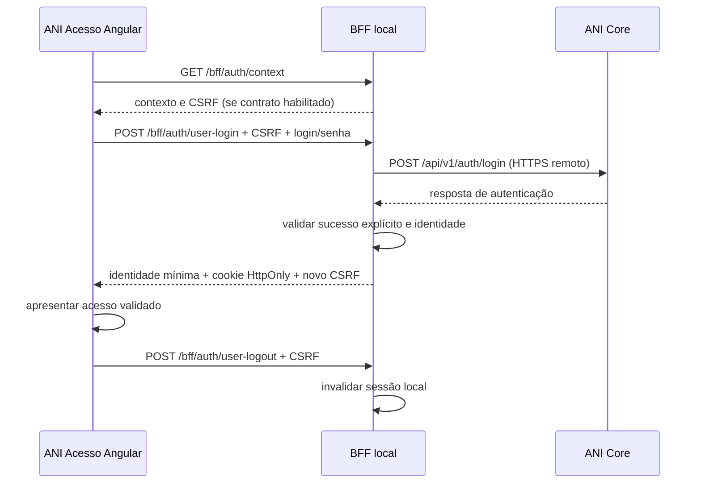

# Levantamento V1 — login e jornada ponta a ponta

Atualização: 2026-10-31. Este documento diferencia implementação local, contrato confirmado e pendências; não registra aprovação de arquitetura de identidade nem liberação para produção.

## Diretriz solicitada e contrato encontrado

O usuário solicitou desenvolver a jornada em que o ANI Acesso recebe login/senha, consulta a API e apresenta o resultado para prosseguir. A direção anterior de OIDC/Cognito era recomendação pendente, não implementação existente. A implementação desta entrega atende à integração local de credenciais solicitada; não cria um provedor OIDC próprio nem declara o fluxo atual pronto para autenticação multiaplicação.

O Swagger foi relido nesta entrega: `POST /api/v1/auth/login`, `POST /api/v1/auth/validar-credenciais` e `POST /api/auth/login` recebem `ValidarCredenciaisRequest` com `login` e `senha`. As respostas do Swagger continuam descritas somente como `200 OK`, sem schema. O usuário forneceu o retorno de sucesso do endpoint versionado `/api/v1/auth/login`: `token`, `tokenType`, `expiresInSeconds` e `usuario`. O adaptador foi alinhado a esse formato; aliases e regras de erro ainda precisam de documentação pelo analista.

O usuário confirmou explicitamente que o endereço é QA autorizado e que a conta fornecida é sintética. O login válido foi exercitado no cliente BFF e no navegador: tela → BFF → Core QA → sessão ativa. Credenciais e token não foram gravados nos arquivos de projeto nem incluídos nas evidências.

## Implementado

- Tela usa formulário real, estado de preparação, carregamento e prevenção de submissão repetida, validação de limites, mensagens genéricas para credenciais inválidas, indisponibilidade e tentativas excessivas.
- A senha não é enviada em URL nem persistida em storage. O campo é limpo no envio e ao abrir solicitação de acesso. A senha não é normalizada com trim. A visibilidade volta a oculta no envio.
- Caixa antirobô demonstrativa removida. Limites reais no BFF continuam ativos; um CAPTCHA verdadeiro, se exigido pelo risco/negócio, precisa de contrato próprio e verificação no servidor.
- BFF recebe apenas login/senha e valida tipo, campos e limites. Exige Origin permitido e CSRF vinculado ao contexto de pré-login. O contexto dura no máximo cinco minutos.
- Chamadas Core têm rota fixa, timeout de cinco segundos, limite de resposta de 64 KiB, redirects bloqueados e nenhuma repetição automática. Credenciais e resposta bruta não entram nos logs.
- Somente um retorno válido com Bearer token, validade, identidade e status `Ativo` cria sessão. HTTP 200 sem esse contrato não vira sucesso. Token fica apenas na memória do BFF e não é retornado ao Angular; não há autorização por nome de perfil.
- A sessão usa cookie opaco `HttpOnly; SameSite=Strict; Path=/bff/auth`, expira no menor prazo entre validade retornada do token e 30 minutos absolutos, com 15 minutos ociosos, e é rotacionada no sucesso. É a mesma sessão usada pelo Admin local; capacidades vêm exclusivamente dos códigos de permissão devolvidos pelo Core. O acesso por chave técnica foi removido.
- GET `/bff/auth/user-session` permite consultar o estado; POST `/bff/auth/user-logout` invalida a sessão. Isso é logout **local**: revogação central ainda não tem contrato.
- Depois do sucesso, a tela mostra a identidade mínima e o estado de sessão ativa. Não há redirecionamento arbitrário por query string nem token em URL. O destino local de continuação é o ANI Admin em origem fixa permitida; não é aceito destino arbitrário de query string.

O servidor permanece exclusivamente em loopback e development/test; cookies sem Secure se limitam a HTTP local. Não publicar esse servidor sem o desenho de produção aprovado.

## Contrato de autenticação informado e verificado

O contrato padrão é `ANI_LOGIN_CONTRACT=core-bearer-v1`. Use `disabled` para desativar o recebimento de credenciais. Campo vazio ou ausente usa o contrato Bearer, pois o formato foi fornecido e o login válido foi verificado no QA autorizado.

O adaptador exige `tokenType=Bearer`, token de tamanho/formato limitado, validade inteira positiva até 24 horas e `usuario.id` UUID, `usuario.nome` válido e `usuario.status=Ativo`. O retorno público do BFF é apenas `{configured,authenticated,csrfToken,user:{id,displayName}}`. O token e dados adicionais recebidos do Core permanecem fora da resposta ao browser. Não foram copiados para esta documentação o token, senha ou dados da conta do QA.

O BFF obtém o token diretamente do endpoint de login em origem HTTPS fixa. Não aceita token fornecido pelo navegador nem usa decode de JWT como prova de assinatura. Este trabalho não certifica a implementação criptográfica do Core nem substitui sua autorização por endpoint.

HTTP 400/401/403/422 no login são normalizados para mensagem genérica de credenciais inválidas. Foi observado HTTP 422 com `application/problem+json` no Core para entrada sintética inválida; o adaptador foi corrigido e o caso foi coberto por regressão. A verificação posterior no QA retornou 401 pelo cliente BFF, e a tela apresentou “Login ou senha inválidos.”. Resposta ambígua, token ausente, identidade inválida e corpo fora do limite não criam sessão.

## O que falta para afirmar V1 100% ponta a ponta

| Prioridade | Pendência | Responsável a confirmar | Evidência de conclusão |
|---|---|---|---|
| P0 | Documentar schema/status de login inválido; aliases e regras de conta | Analista Core | Sucesso e rejeição 422→401 já verificados; completar OpenAPI com schemas e demais regras de conta |
| Concluído nesta sessão | Ambiente de QA e conta sintética autorizados pelo usuário | Usuário/Core | Login válido confirmado no cliente e na tela; não comprova demais regras de conta |
| Concluído para Admin local | Destino após o OK: ANI Admin | Usuário/front-end | Admin sem sessão → ANI Login → login válido → continuar para Admin; consumidores externos continuam pendentes |
| P0 | Definir como a sessão autoriza chamadas e comprova o ator no Core/consumidor | Core/identidade | Core valida identidade/autorização a cada operação; permissão revogada deixa de funcionar conforme regra definida |
| P0 | Criação/ativação de usuário e definição de senha/recuperação | Core/negócio | Forma aprovada de provisionar conta de QA e ciclo de vida; sem senha padrão compartilhada |
| P0 | Recursos fora da API publicada | Core/escopo V1 | Implementar catálogo, solicitações, decisão e relatórios, ou aprovar explicitamente sua retirada da V1 |
| P1 | Logout/revogação central, expiração e eventual renovação | Core/identidade | Contrato e testes comprovando encerramento e revogação; definir comportamento entre sistemas |
| P1 | Abuso de credenciais, bloqueio progressivo, eventual MFA/CAPTCHA e auditoria de autenticação | Segurança/Core | Controles efetivos no servidor e evidências em ambiente de QA; regras aprovadas |
| P1 | Implantação segura e sessão compartilhada | Infra/segurança | HTTPS, Secure cookies, segredo gerenciado, sessão/rede/limites/logs e observabilidade revisados |
| P1 | Build Admin e QA funcional/acessibilidade | Front/QA | Corrigir orçamento CSS do Admin, executar jornadas desktop/mobile/teclado e regressão |

A sessão do usuário libera somente as operações administrativas expressamente mapeadas pelas permissões do Core e pelos limites de escrita do BFF. Essa integração local não representa um protocolo SSO para consumidores externos. O endpoint de login emite Bearer token, conforme retorno informado e verificado. A exigência e validação desse token nos demais endpoints, a matriz de autorização e a revogação ainda precisam de evidência; a informação anterior de que a API estava sem camada de acesso não deve ser tratada como prova do estado atual de todos os endpoints.

## Recursos usados pelo projeto sem endpoint publicado

- GET/POST `/portais`; GET/PUT/DELETE `/portais/{id}`.
- GET/POST `/solicitacoes-cadastro`; GET `/solicitacoes-cadastro/{id}`; POST `/solicitacoes-cadastro/{id}/aprovar`; POST `/solicitacoes-cadastro/{id}/rejeitar`.
- GET `/relatorios/acessos`.

Não substituir solicitação pública por criação administrativa de usuário. Aprovação/provisionamento, deduplicação, comprovação de e-mail e escopo por sistema continuam pendentes.

## Verificações desta implementação

- Onze testes BFF passaram com Core sintético HTTP em loopback, incluindo login explícito, falha em HTTP 200, rejeição de resposta ambígua, rotação de cookie, separação de permissões, logout e corrida entre submissão concorrente/encerramento de contexto.
- Cinco testes da tela passaram: campos, indisponibilidade sem contrato, envio único com CSRF, limpeza de senha, sucesso/logout e falha genérica.
- Checagem TypeScript e build de produção do ANI Acesso passaram. O bloqueio de orçamento CSS de produção do Admin, identificado na entrega anterior, continua pendente e não foi alterado nesta etapa.
- Login válido verificado contra QA autorizado: cliente BFF e navegador mostraram identidade/sessão ativa, sem repassar o token à tela. Entrada sintética inválida retornou 422 no Core, normalizada a 401 pelo BFF após correção; a tela exibiu a mensagem esperada. Refresh manteve a sessão; logout e novo refresh confirmaram encerramento. Os demais cenários negativos e concorrência foram verificados somente com fixtures sintéticas locais.

## Roteiro de aceite integrado após alinhamento

1. Iniciar BFF/API e ANI Acesso com configuração do contrato confirmado e dados sintéticos autorizados.
2. Usuário/senha inválidos: sem sessão, sem enumeração, sem redirect e sem dados sensíveis na resposta/log.
3. Credenciais válidas: identidade correta, cookie rotacionado, senha limpa e sucesso explícito; refresh recupera a sessão.
4. Tentar repetir submissão, remover CSRF, trocar origem, manipular payload e exceder limites; negar sem conceder sessão indevida.
5. Core indisponível/timeout/JSON inválido: mensagem útil e nenhuma sessão criada.
6. Expirar sessão e encerrar sessão; comprovar o comportamento de revogação definido para Core e consumidores.
7. Prosseguir para o destino aprovado e comprovar autorização no servidor consumidor. Não aceitar identidade ou permissões enviadas pelo JavaScript como prova.
8. Completar os fluxos restantes da V1 e registrar evidências de build, QA funcional, teclado, mobile e segurança antes da liberação.

## Evidências e prévia local

A verificação isolada usa ANI Acesso em `http://127.0.0.1:4311` e BFF em loopback `3433`, com escritas administrativas desabilitadas. Esses processos são temporários; o início reproduzível normal segue `conexao-core.md` e `.env.example`. Não sobrescrevem os serviços já existentes nas portas usuais.

Evidências sem senha/token: [login validado](../../outputs/qa-login/login-validado.jpg), [logout confirmado](../../outputs/qa-login/logout-confirmado.jpg) e [login inválido](../../outputs/qa-login/login-invalido.jpg). A imagem de sucesso contém somente o nome de exibição da conta sintética autorizada. Nenhum Bearer ou segredo foi incluído nos arquivos.

## Correção final do acesso ao Admin

A chave técnica e o endpoint de entrada por chave foram removidos. Sem sessão o Admin encaminha ao ANI Login. Após sucesso, “Continuar para administração” abre o Admin com a mesma sessão opaca e Bearer mantido no BFF. A resposta atual do QA contém permissões como objetos com `codigo`; somente esses códigos (ou strings equivalentes na serialização anterior) são utilizados. `usuarios.manage` permite leitura de usuários; escrita ainda depende da configuração explícita. Nomes de perfil não concedem permissões. Foram verificados no navegador o fluxo completo e logout pelo Admin, sem operações de escrita. Testes: 11 BFF, 3 Admin e 5 Login passaram. Evidência: [Admin acessado com login e senha](../../outputs/qa-login/admin-login-senha.jpg).
